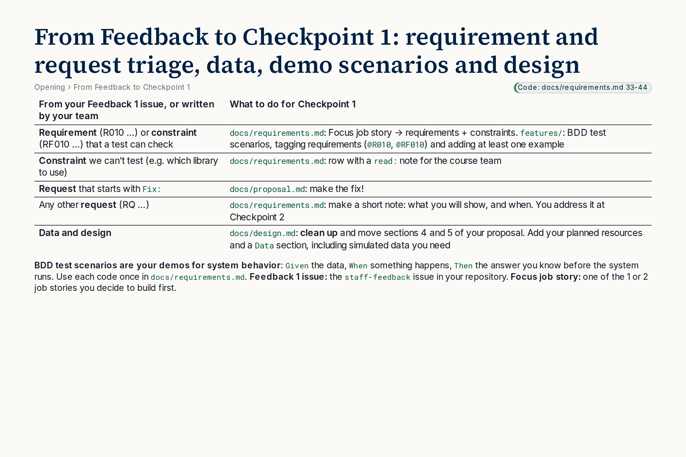
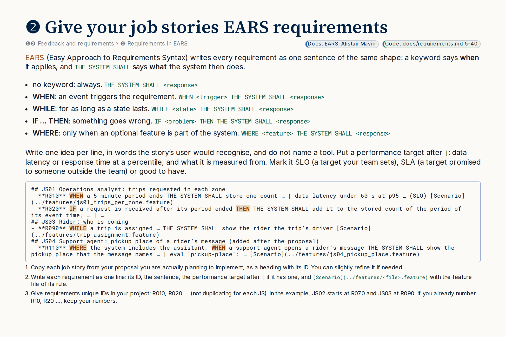
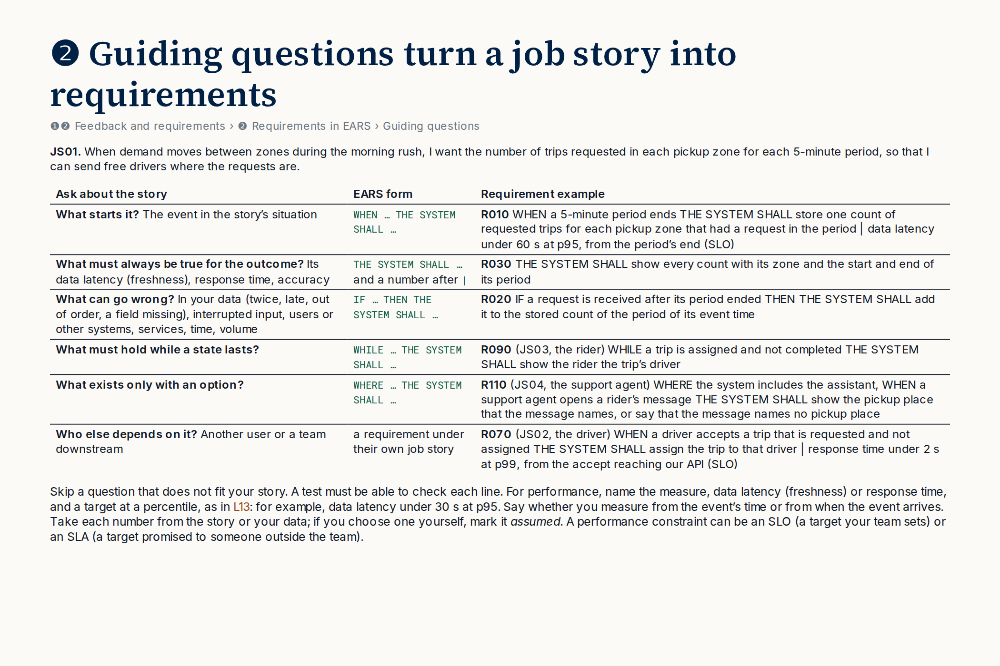
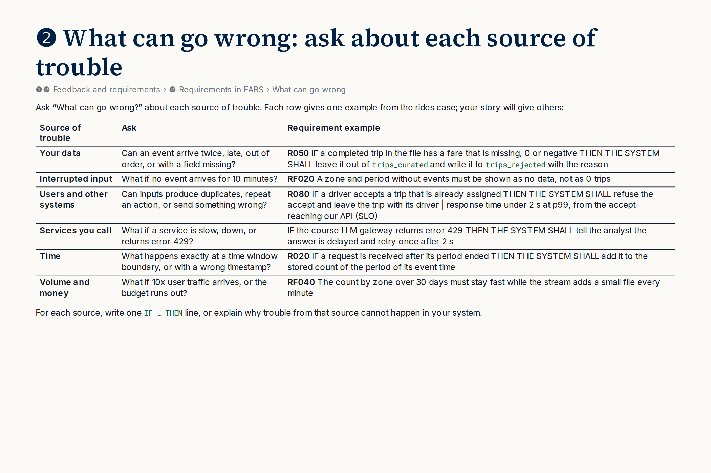
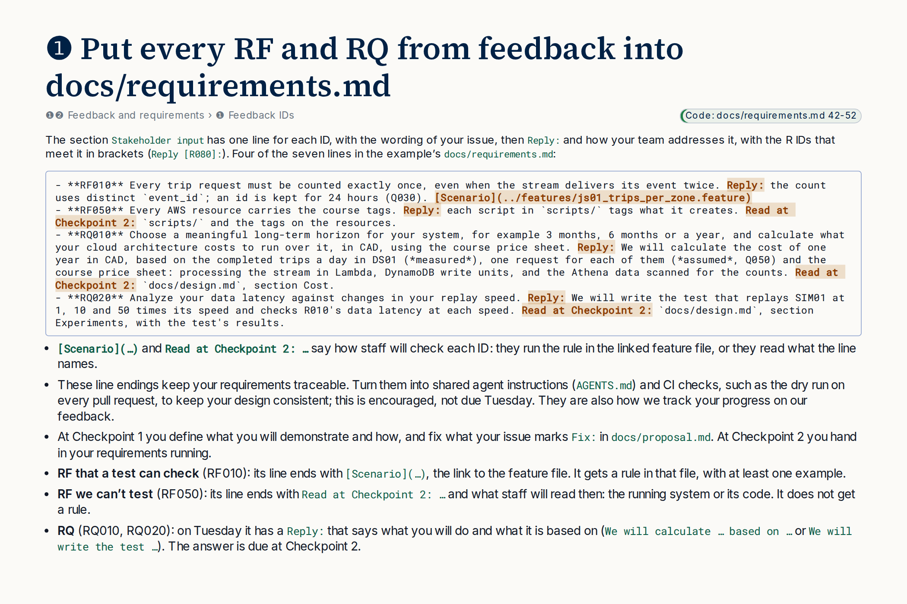
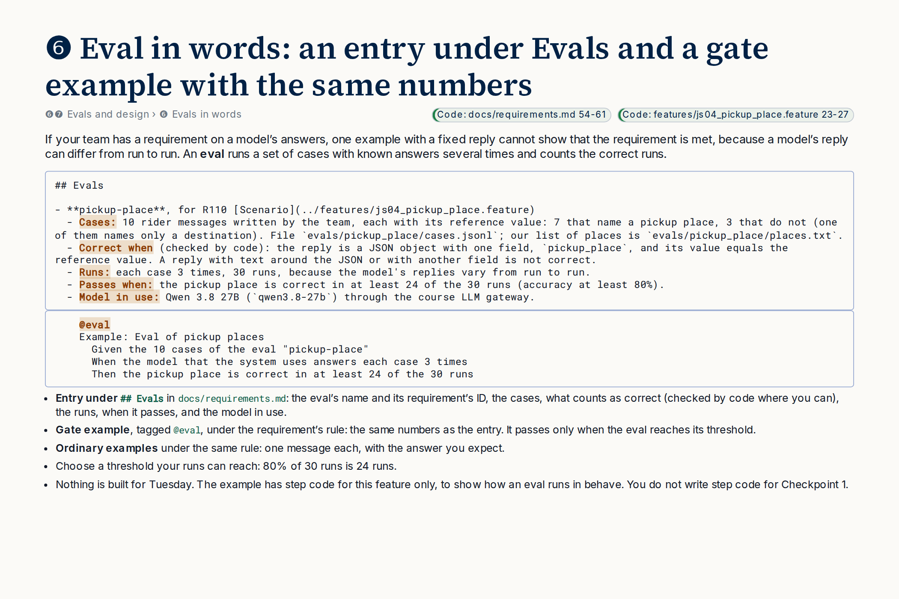
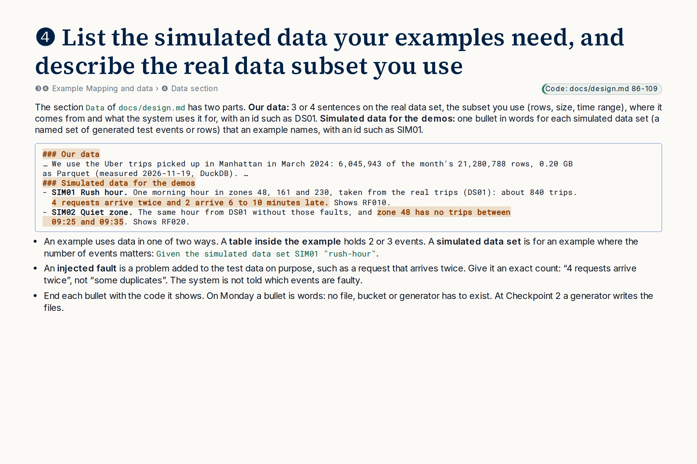
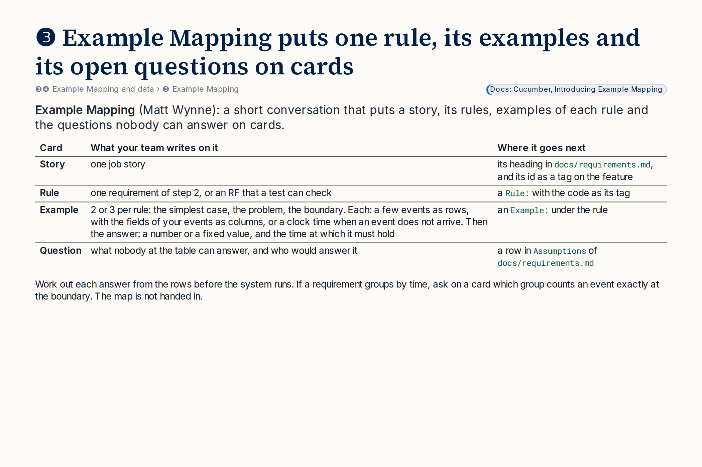
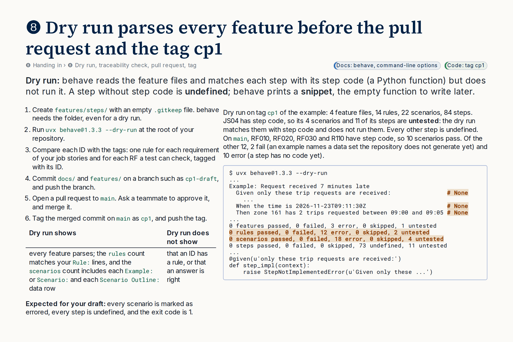

```{=html}
<style>pre, pre code { white-space: pre; overflow-x: auto; }</style>
```

In this checkpoint, you make the corrections that your Feedback 1 issue asks for, write your requirements and your
design, and draft the behave scenarios that will test them. You do not write step code or scripts, generate data
files, create AWS resources or answer the requests (RQ) for it. The checkpoint is due **Monday 23 November, end of
day**. You hand it in with a pull request from a branch such as `cp1-draft` to `main`. A teammate approves it, you
merge it, and you tag the merged commit on `main` as `cp1`.

Words used on this page:

- **Job story:** who needs what and why, from your proposal, with an id such as JS01.
- **RF code, RQ code:** an item of your Feedback 1 issue. An **RF** (constraint) is a requirement that staff added:
  mostly something the running system must do, sometimes how it is built. An **RQ** (request) is something you write and show us, such as a
  calculation or a decision.
- **Feature, rule, example:** a feature file in Gherkin, the plain-text format behave reads, holds rules. A
  **rule** states one requirement. An **example** under it shows the rule with data and a known answer, in steps
  that start with `Given`, `When` and `Then`. behave's output calls an example a scenario.
- **Tag:** a label that starts with `@` on the line above a feature, rule or example, such as `@RF010`. A git tag
  such as `cp1` is a different thing: a name for one commit.
- **Simulated data set:** events or files that your team will generate from a real data set, so that a test knows
  every event that was sent. On Monday a simulated data set is a bullet of words in your design, with an id
  such as SIM01; you do not generate it yet.
- **Injected fault:** a problem that simulated data contains on purpose, such as an event that arrives twice. It
  is recorded beside the data, so that the test knows the right answer.
- **Dry run:** behave reads the feature files and lists the steps, without running any code.

## Checklist

1. [In `docs/proposal.md`, make the corrections that RQs whose text starts with `Fix:` ask for](#fixes).
2. [Write `docs/requirements.md`](#requirements).
3. [Create `docs/design.md`](#design).
4. [Draft your scenarios in `features/`](#scenarios).
5. [Check the scenarios with a dry run and by reading each code against the tags](#dry-run).
6. [Open a pull request from a branch such as `cp1-draft`, merge it when a teammate approves it, tag the merged
   commit on `main` as `cp1` and push the tag](#hand-in).

The minimum for Monday is small: 1 or 2 focus job stories with 3 to 6 requirements each, the RF and RQ codes of
your issue, your design with sections 4 and 5 of your proposal moved in, its list of planned resources and its
`## Data` section, and at least one example for each rule.

The examples on this page come from a Checkpoint 1 hand-in that we wrote for a team t00 on the rides case of the
lectures: a ride-hailing app in New York that sends trip events (a trip is requested, accepted, completed). Its data
is built on public New York trip records. The whole hand-in is the repository
[cp1-example](https://github.com/cpsc436c-2026w1/cp1-example), tag `cp1`: open its `docs/` and `features/`
folders when you want to see a part of this page in full.

## What changes in your repository {#repo}

The [example repository at tag `cp1`, the tag you hand in](https://github.com/cpsc436c-2026w1/cp1-example/tree/cp1) is a whole Checkpoint 1 hand-in, written for the rides
case. Each file name below links to it in that state.

```{=html}
<style>
.repo-tab { width: 100%; border-collapse: collapse; font-size: 0.9em; margin: 0.6em 0 0.3em; }
.repo-tab td { padding: 0.18em 0.5em; vertical-align: top; border-bottom: 1px solid #eee; }
.repo-tab td.t { font-family: SFMono-Regular, Menlo, Consolas, monospace; white-space: nowrap; font-size: 0.92em; }
.repo-tab td.t a { color: #1f4e8c; text-decoration: underline; }
.repo-tab .add, .repo-legend .add { background: #d9f2df; color: #14532d; font-weight: 600; padding: 0 0.35em; border-radius: 3px; white-space: nowrap; }
.repo-tab .fill, .repo-legend .fill { background: #fff1c2; color: #6b4b00; font-weight: 600; padding: 0 0.35em; border-radius: 3px; white-space: nowrap; }
.repo-tab .chg, .repo-legend .chg { background: #fde2e1; color: #8a1c14; font-weight: 600; padding: 0 0.35em; border-radius: 3px; white-space: nowrap; }
</style>
<table class="repo-tab">
<tr><td class="t">your-repository/</td><td><span class="add">add</span></td><td>tag <code>cp1</code> on <code>main</code>, after your pull request is merged</td></tr>
<tr><td class="t">├── docs/</td><td></td><td></td></tr>
<tr><td class="t">│&nbsp;&nbsp;&nbsp;├── <a href="https://github.com/cpsc436c-2026w1/cp1-example/blob/cp1/docs/proposal.md">proposal.md</a></td><td><span class="chg">change</span></td><td>the corrections asked for by <b>Fix:</b> requests</td></tr>
<tr><td class="t">│&nbsp;&nbsp;&nbsp;├── <a href="https://github.com/cpsc436c-2026w1/cp1-example/blob/cp1/docs/requirements.md">requirements.md</a></td><td><span class="fill">fill in</span></td><td>job stories, requirements in EARS, a row for every RF and RQ</td></tr>
<tr><td class="t">│&nbsp;&nbsp;&nbsp;└── <a href="https://github.com/cpsc436c-2026w1/cp1-example/blob/cp1/docs/design.md">design.md</a></td><td><span class="fill">fill in</span></td><td>sketch, workflows, planned resources, Data</td></tr>
<tr><td class="t">└── features/</td><td></td><td></td></tr>
<tr><td class="t">&nbsp;&nbsp;&nbsp;&nbsp;├── <a href="https://github.com/cpsc436c-2026w1/cp1-example/blob/cp1/features/js01_trips_per_zone.feature">js01_trips_per_zone.feature</a></td><td><span class="add">add</span></td><td>demo scenarios: rules tagged with codes, examples (one file per focus job story)</td></tr>
<tr><td class="t">&nbsp;&nbsp;&nbsp;&nbsp;├── <a href="https://github.com/cpsc436c-2026w1/cp1-example/blob/cp1/features/js01_yesterdays_trips.feature">js01_yesterdays_trips.feature</a></td><td><span class="add">add</span></td><td></td></tr>
<tr><td class="t">&nbsp;&nbsp;&nbsp;&nbsp;└── <a href="https://github.com/cpsc436c-2026w1/cp1-example/tree/cp1/features/steps">steps/.gitkeep</a></td><td><span class="add">add</span></td><td>empty for now: step code comes at Checkpoint 2</td></tr>
</table>
<p class="repo-legend"><span class="add">add</span> a new file or tag &nbsp; <span class="fill">fill in</span> a course template you already have &nbsp; <span class="chg">change</span> a file you wrote</p>
```

| File | Kiro keeps the same thing in | Codes in it |
|---|---|---|
| `docs/requirements.md` | `requirements.md`: stories with acceptance criteria in EARS | defines JS01, R010, RF010, RQ010 once |
| `docs/design.md` | `design.md`: architecture | uses the codes each resource and data set serves |
| `features/*.feature` | — | tags: `@JS01` on a feature, `@R010` or `@RF010` on a rule |

: {tbl-colwidths="[26,46,28]"}

**`docs/` says what you build, `features/` says how you show it.**

## Make the corrections I asked for in the proposal feedback issue {#fixes}

::: {.callout-note collapse="true" title="Useful slides: From Feedback to Checkpoint 1: triage"}
{fig-alt="L19 slide: From Feedback to Checkpoint 1: triage"}
:::

In your `staff-feedback` issue, among the constraints (RF010, RF020 …) and requests (RQ010, RQ020 …), some RQs
start with **Fix:**. Each of them asks for a correction to your `docs/proposal.md` that you complete for Checkpoint 1.

We discuss what to do with all other RQs and RFs in the [next step](#codes). Briefly: for each other RQ, you give me
a short response in Checkpoint 1 on how you would reply to it; the actual solution waits until Checkpoint 2.

If something in the issue does not match what your proposal says, reply in the issue.

## Write docs/requirements.md {#requirements}

::: {.callout-note collapse="true" title="Useful slides: How EARS writes a requirement, Guiding questions turn a job story into requirements, What can go wrong"}
{fig-alt="L19 slide: How EARS writes a requirement"}

{fig-alt="L19 slide: Guiding questions turn a job story into requirements"}

{fig-alt="L19 slide: What can go wrong"}
:::

The file has a heading for each job story, your own requirements under each focus story, and one table for the codes
of your issue.

### Job stories and requirements

1. Copy each job story from your proposal as a heading with its id, and mark each focus story `(focus)`:
   `## JS01 <user>: <title> (focus)`.
2. Under each focus story, write 3 to 6 requirements, one line each, in EARS form.
   **[EARS](https://alistairmavin.com/ears/)** is a fixed sentence pattern: an optional opening from the table below, then
   `THE SYSTEM SHALL` and what the system does. Number requirements R010, R020 … across the whole file: your
   second story continues from the next free code and does not start again at R010. If you already number R10,
   R20 …, keep your numbers.
3. End each line with `· BDD:` and a link to the feature file whose rule carries the code, such as `[js01_trips_per_zone.feature](../features/js01_trips_per_zone.feature)`.
4. When the requirement has a number, put it after a `|`, with its status in brackets: **SLO** (service level
   objective, a target your team sets for the running system), **SLA** (service level agreement, a target promised
   to someone outside the team) or **good to have**. *Measured*, *estimate* and *assumed* say where a number about
   your data comes from; they do not go after `|`.

A requirement that serves two stories sits under the first one; the other story names its code in one sentence.

| EARS form | Use it for | Ask about your story |
|---|---|---|
| `WHEN <trigger> THE SYSTEM SHALL <response>` | what the system does when something happens | What must the system do or show, and what starts it? |
| `WHILE <state> THE SYSTEM SHALL <response>` | what holds as long as a state lasts | What is going on while it happens? |
| `IF <problem> THEN THE SYSTEM SHALL <response>` | a problem in your data or your services | What would make the story's outcome false: repeated, late, out of order, missing? |
| `THE SYSTEM SHALL <response>` | what is always true | What must always hold for the outcome? |
| `WHERE <feature> THE SYSTEM SHALL <response>` | behaviour that exists only with your extension | Which behaviour comes with the extension? |

: {tbl-colwidths="[34,30,36]"}

Two openings can be combined: `WHERE <feature>, WHEN <trigger> THE SYSTEM SHALL <response>` is behaviour of your
extension that something starts.

Here is part of the example's `docs/requirements.md`. Three things help you read it:

- DS01 is a real data set, listed in the `## Data` section of `docs/design.md` (see
  [Create docs/design.md](#design)). A number that comes from a data set names its id.
- A 5-minute period holds the requests from its start up to, and not including, its end.
- `count-answers` in R060 is an eval: a set of test cases for the model's answers (see
  [Requirements on model answers](#evals)).

```markdown
## JS01 Operations analyst: trips requested in each zone (focus)

When demand moves between zones during the morning rush (about 840 requests an hour in our three zones, from DS01), I want the
number of trips requested in each pickup zone for each 5-minute period, and each morning yesterday's completed trips
in one table, so that I can send free drivers where the requests are and check yesterday's fares.

- **R010** WHEN a 5-minute period ends THE SYSTEM SHALL store one count of requested trips for each pickup zone that had a request in the period | data latency under 60 s at p95, from the period's end to the stored count of the requests received by then (SLO) · BDD: [js01_trips_per_zone.feature](../features/js01_trips_per_zone.feature)
- **R020** IF a request is received after its period ended THEN THE SYSTEM SHALL add it to the stored count of the period of its event time, and store a count of 1 if its zone does not have a count for that period yet | for a request received up to 10 minutes after its event time, data latency under 60 s at p95, from its receipt to the corrected count (SLO) · BDD: [js01_trips_per_zone.feature](../features/js01_trips_per_zone.feature)
- **R030** THE SYSTEM SHALL show every count with its zone and the start and end of its period · BDD: [js01_trips_per_zone.feature](../features/js01_trips_per_zone.feature)
- **R060** WHERE the system includes the assistant, WHEN the analyst asks about trip counts in plain language THE SYSTEM SHALL answer with the count the question asks for and state only counts that are in the rows its query returned | eval `count-answers` scores at least 0.8, which is 5 of its 6 cases correct (SLO) · BDD: [js01_count_questions.feature](../features/js01_count_questions.feature)
```

### Put every RF and RQ from feedback into docs/requirements.md {#codes}

::: {.callout-note collapse="true" title="Useful slides: Every RF and RQ into docs/requirements.md"}
{fig-alt="L19 slide: Every RF and RQ into docs/requirements.md"}
:::

In a section `## Constraints and requests`, add one row for every RF and RQ code of your issue, with its code and
its wording. RF and RQ codes keep the numbers of your issue.

- For an **RF** code, say what you will do and how it is checked. For an RF that a test can check, the check
  starts with `BDD:` and links the feature file whose rule carries the code. For an RF we can't test, such as the
  tags on your resources, the check starts with `read:`.
- For each **RQ** code, write a short note: what you will show, and when. The answer is due at Checkpoint 2.
- For an **RQ whose text starts with `Fix:`**, make the correction in `docs/proposal.md` by Monday.

Here are four rows of the example's table. `event_id` is the id of one event, and Q030 is a question in its
`## Assumptions` table (see [Questions the case does not answer](#assumptions)).

```markdown
| Code | Constraint or request | What we do or will show | Check | Due | Issue |
|---|---|---|---|---|---|
| RF010 | Every trip request must be counted exactly once, even when the stream delivers its event twice. | the count uses distinct `event_id`; an id is kept for 24 hours (Q030) | BDD: [js01_trips_per_zone.feature](../features/js01_trips_per_zone.feature) | cp2 | |
| RF030 | Say what happens when two drivers accept the same trip at the same moment, and show it. | the write that assigns a trip has a condition: the trip is not assigned yet (R080) | BDD: [trip_assignment.feature](../features/trip_assignment.feature) | cp2 | |
| RF050 | Every AWS resource carries the course tags. | each script in `scripts/` tags what it creates | read: `scripts/` and the tags on the resources | cp2 | |
| RQ010 | Say how long raw events are kept and who may delete them. | note for cp1: at Checkpoint 2, `docs/design.md`, section Data, gives the days raw events are kept, the rule that deletes them and the role that may delete them | read: `docs/design.md`, section Data | cp2 | |
```

**Check** says how staff will check the code: they run the rule in the linked feature file, or they read what
`read:` names. **Due** says when staff check it: Checkpoint 2 (`cp2`) in every row. In the example, the rule and its example
for RF010 are written by Monday, and staff run them at Checkpoint 2.

The `Issue` column is empty in the example. You do not have to open a GitHub issue for each code for Monday, so
you can leave that column out.

### Requirements on model answers {#evals}

::: {.callout-note collapse="true" title="Useful slides: Eval in words"}
{fig-alt="L19 slide: Eval in words"}
:::

If your system includes a model, its answer can differ between runs, so one example with a fixed reply does not
show the requirement. Describe an **eval** in words in a section `## Evals`: a set of cases with known answers that
the model's part of your system is run on, and the score it gets. Give the requirement it is for, the cases, what
counts as correct, and a threshold that the number of cases can reach: with 6 cases, a score of at least 0.8 means
at least 5 of 6 correct, and 0.9 would ask for all 6.

```markdown
| Eval | For | Cases | What counts as correct | Threshold |
|---|---|---|---|---|
| `count-answers` | R060 | 6 questions with the rows their query returns: 4 with the count, 2 with 0 rows (injected fault `no-rows`) | checked by code: the reply states the count asked for and only counts in the rows; without rows it says there is no data | 0.8: at least 5 of 6 |
```

### Questions the case does not answer {#assumptions}

When your case does not say something that a requirement depends on, add a row to a section `## Assumptions`:
the question with an id (Q010, Q020 …), who would answer it, what you assume, and the codes it affects.

```markdown
| Id | What the case does not say | Who would answer | We assume | Affects |
|---|---|---|---|---|
| Q010 | Does a trip that the rider cancels still count as requested? | the operations analyst | yes, the count is of requests | R010, RF010 |
| Q030 | Can the app send an event again more than 24 hours after it first sent it? | the app's team | no: the app's retries end within minutes | RF010 |
```

## Create docs/design.md {#design}

::: {.callout-note collapse="true" title="Useful slides: docs/design.md lists each planned resource"}
{fig-alt="L19 slide: docs/design.md lists each planned resource"}
:::

Write `docs/design.md` from sections of your proposal: the course does not give a template for it.

1. Move sections 4 (data and workflows) and 5 (the sketch) of your proposal into `docs/design.md`, and clean them up where your feedback asks. The sketch
   image moves with section 5: link it from `docs/design.md`. Leave a line in `docs/proposal.md` that points to
   the new file.
2. Add a section `## Resources`: one row for each AWS resource you plan, with its name, the script in `scripts/`
   that will create it, and the codes it serves. On Monday each row names its script, such as
   `scripts/stream.py up`; the scripts and the resources do not exist yet. You write the scripts at Checkpoint 2.
   For example:

   ```markdown
   | Resource | Name | Created by | Serves |
   |---|---|---|---|
   | Kinesis data stream | `t00-trip-events` | `scripts/stream.py up` | R010, R020, RF010 |
   | Lambda function | `t00-count-requests` | `scripts/counting.py up` | R010, R020, RF010, RF020 |
   | DynamoDB tables | `t00-zone-counts`, `t00-seen-events` | `scripts/counting.py up` | R010, R030, RF010, RF020 |
   ```

3. Add a section `## Data`, described [below](#data), including the simulated data your scenarios need.

### Data section {#data}

::: {.callout-note collapse="true" title="Useful slides: Simulated data and the real data subset, One line of fields for each kind of event"}
{fig-alt="L19 slide: Simulated data and the real data subset"}

{fig-alt="L19 slide: One line of fields for each kind of event"}
:::

The `## Data` section has two parts:

1. `### Our data`: 3 or 4 sentences on the real data set your system is built on: the subset you use (rows, size,
   time range), where it comes from, and what the system uses it for. Give each data set an id, such as DS01, and
   mark each number *measured* (you ran a query), *given* (a page of the source states it) or *our choice*.
2. `### Simulated data for the demos`: one bullet in words for each simulated data set that your examples name,
   with an id such as SIM01: what it holds, its injected faults with exact counts, and the code it shows. Then one
   line for each kind of event, naming the fields that your examples' tables use: the columns of every example
   table come from these lines, so all examples use the same names.

Write both parts as text on Monday: no file, bucket or generator has to exist. An injected fault is not a field of
an event, because the system you test must not be told which events are faulty: the bullet names the faults. At
Checkpoint 2 a generator writes the files, and each line of event fields becomes a Pydantic model with types and
valid values.

The example's `Our data`:

```markdown
### Our data

DS01 is the High Volume For-Hire Vehicle trip records of the NYC Taxi and Limousine Commission: one row for each
finished trip, one [Parquet file a month](https://d37ci6vzurychx.cloudfront.net/trip-data/fhvhv_tripdata_2024-03.parquet)
over HTTPS ([trip record page](https://www.nyc.gov/site/tlc/about/tlc-trip-record-data.page)). We use the Uber trips
picked up in Manhattan in March 2024: 6,045,943 of the month's 21,280,788 rows, 0.20 GB as Parquet (*measured*
2026-11-19, DuckDB). DS02, the TLC [taxi zone lookup](https://d37ci6vzurychx.cloudfront.net/misc/taxi_zone_lookup.csv),
gives the borough and name of each of its 265 zones. The system's events are simulated from DS01 rows of zones 48,
161 and 230, with their times moved to 2026-11-23.
```

Two of the example's five bullets, and its event fields:

```markdown
### Simulated data for the demos

- **SIM01 Rush hour.** One morning hour in zones 48, 161 and 230, taken from the real trips (DS01): about 840 trips.
  4 requests arrive twice and 2 arrive 6 to 10 minutes late. Shows RF010.
- **SIM02 Quiet zone.** The same hour from DS01 without those faults, and zone 48 has no trips between 09:25 and
  09:35. Shows RF020.

**Event fields the scenarios use** (each delivery also has `received_time`, set when the event arrives):

- `trip_requested`: `event_id`, `trip_id`, `pickup_zone_id`, `event_time`
- `trip_accepted`: `event_id`, `trip_id`, `driver_id`, `event_time` (also the body of an accept sent to the API)
- `trip_completed`: `trip_id`, `driver_id`, `dropoff_zone_id`, `trip_miles`, `trip_time_s`, `fare`, `driver_pay`,
  `event_time`
```

The id links the bullet, the folder `sim/data/SIM01/` at Checkpoint 2, and the `Given` of each example that uses
it.

## Draft your scenarios in features/ {#scenarios}

::: {.callout-note collapse="true" title="Useful slides: Example Mapping cards, One rule, three example cards, Cards become a feature file"}
{fig-alt="L19 slide: Example Mapping cards"}

{fig-alt="L19 slide: One rule, three example cards"}

{fig-alt="L19 slide: Cards become a feature file"}
:::

BDD test scenarios are your demos of the system's behaviour: `Given` the data, `When` something happens, `Then` the answer you know before the system runs.

Write the scenarios in Gherkin, in a folder `features/` in your repository:

1. **Feature:** by default one feature file for each focus job story, named for what the user gets. A feature
  carries the tag of every job story it serves (`@JS01`, or `@JS02 @JS03` when two users read the same thing).
2. **Rule:** one `Rule:` for each of your requirements of a focus story and for each RF that a test can check,
  tagged with its code (`@R010`, `@RF010`). Each code is one rule in one feature. RQ codes and `read:` RF codes do
  not get a rule.
3. **Where an RF rule goes:** in the feature of the job story that the constraint is about. When one of your own
  requirements is how you meet the constraint, write one rule with both codes: in the example, R080 (refuse the
  second accept of a trip) meets RF030 (two drivers accept the same trip), so its rule is tagged `@R080 @RF030`.
4. **Example:** at least one `Example:` under each rule, with an answer that you know before the system runs. Put a
  few events in a table inside the example, with the event fields of your `## Data` section as columns. When
  the number of events matters, such as a whole hour, name a simulated data set by its id and name:
  `Given the simulated data set SIM01 "rush-hour"`.

Here is part of the example's `features/js01_trips_per_zone.feature`. Its table columns are fields of the
events: `event_id` (one id for one event), `trip_id`, `pickup_zone_id`, `event_time` (when the rider asked) and
`received_time` (when the event reached the system).

```gherkin
@JS01
Feature: Trips requested in each zone
  Covers the first part of JS01 (operations analyst): the number of trips requested in each pickup zone for each
  5-minute period. A period holds the requests with an event time from its start up to, and not including, its end.
  A table holds the only events of its example. Its columns are event fields listed in docs/design.md,
  section Data. A simulated data set is named by its id and described in the same section, under Simulated data
  for the demos.

  @R010
  Rule: When a 5-minute period ends, one count of requested trips is stored for each pickup zone that had a request

    Example: Three requests in one period
      Given only these trip requests are received:
        | event_id  | trip_id | pickup_zone_id | event_time           | received_time        |
        | ev-000001 | t-0001  | 161            | 2026-11-23T09:01:10Z | 2026-11-23T09:01:11Z |
        | ev-000002 | t-0002  | 161            | 2026-11-23T09:03:40Z | 2026-11-23T09:03:41Z |
        | ev-000003 | t-0003  | 230            | 2026-11-23T09:04:58Z | 2026-11-23T09:04:59Z |
      When the period between 09:00 and 09:05 ends
      Then within 60 s zone 161 has 2 trips requested between 09:00 and 09:05
      And within 60 s zone 230 has 1 trip requested between 09:00 and 09:05

  # (rules R020 and R030 of the file are left out here)

  @RF010
  Rule: Every trip request is counted exactly once, even when the stream delivers its event twice

    Example: One request delivered twice
      Given only these trip requests are received:
        | event_id  | trip_id | pickup_zone_id | event_time           | received_time        |
        | ev-000101 | t-0101  | 161            | 2026-11-23T09:11:00Z | 2026-11-23T09:11:01Z |
        | ev-000102 | t-0102  | 161            | 2026-11-23T09:12:30Z | 2026-11-23T09:12:31Z |
        | ev-000101 | t-0101  | 161            | 2026-11-23T09:11:00Z | 2026-11-23T09:12:40Z |
      When the counts are read at 2026-11-23T09:16:00Z
      Then zone 161 shows 2 trips requested between 09:10 and 09:15

    # (the second example of RF010, with SIM01, is left out here)

    # Replay limit: a second delivery up to 24 hours after the first is not counted. We assume the app does not
    # send an event again after that (Q030).
    # Question (Q010): does a trip that the rider cancels still count as requested?
```

The `Then` checks one case of the requirement's target: R010 asks for data latency under 60 s at p95 after the period's end, so one example checks that its count is there within 60 s. The percentile is over many periods, which a single example cannot show.
The times in an example are data; nobody waits for them. A line that starts with `#` is a comment, which behave
does not read: `# Question (Q010)` puts the open question of your `## Assumptions` table beside the rule that
depends on it.

For a requirement on a model's answers, the rule has one **gate example**: an example tagged `@eval` that names
the eval of your `## Evals` table and its threshold, and fails when the eval's score is below the threshold. Beside
it go ordinary examples, each with the rows of one query and the reply that the rule allows. Here is the example's
whole `features/js01_count_questions.feature`:

```gherkin
@JS01 @assistant
Feature: Questions about trip counts in plain language
  Covers JS01 (operations analyst) in a system that includes the assistant, our extension.

  @R060
  Rule: Where the system includes the assistant, a reply gives the count the question asks for and states only counts that are in the rows its query returned

    Example: Zone and period without rows
      Given the query for zone 48 between 09:25 and 09:30 returns 0 rows
      When the analyst asks "How many trips were requested in zone 48 between 09:25 and 09:30?"
      Then the reply says there is no data
      And the reply does not state a count

    @eval
    Example: Eval of count answers
      Then the eval "count-answers" scores at least 0.8
```

The guide [Behave for your project](project-behave.qmd#level-0) shows how each EARS form becomes a rule and its
examples, and how to read the dry run's output.

## Check the scenarios {#dry-run}

::: {.callout-note collapse="true" title="Useful slides: Dry run before the pull request and the tag, Traceability check"}
{fig-alt="L19 slide: Dry run before the pull request and the tag"}

{fig-alt="L19 slide: Traceability check"}
:::

1. behave looks for step code in a folder `features/steps/`, even on a dry run. Create the folder with an empty
   file in it, so that git keeps it:

   ```default
   mkdir -p features/steps
   touch features/steps/.gitkeep
   ```

2. In a terminal at the root of your repository, run the dry run:

   ```default
   uvx behave@1.3.3 --dry-run
   ```

   The version is pinned because older versions of behave do not read `Rule:`: behave 1.2.6 stops with a
   `ParserError` at the first `Rule:` line of the example.

You should see your features and examples listed, each example marked as errored, then summary lines. For the four
feature files of the example they are:

```default
0 features passed, 0 failed, 4 error, 0 skipped
0 rules passed, 0 failed, 13 error, 0 skipped
0 scenarios passed, 0 failed, 19 error, 0 skipped
0 steps passed, 0 failed, 0 skipped, 72 undefined
```

At this checkpoint that is the expected result: the examples error and the steps are undefined because they have no
code yet, and the command ends with exit code 1 for the same reason. Check that the `rules` count matches your
`Rule:` lines. The `scenarios` count includes each `Example:` or `Scenario:` line and each data row of a
`Scenario Outline:`. A `ParserError` is not expected: fix the line it names until the dry run reads the file.

3. Read each code against the tags. The dry run does not know your codes, so check by reading that there is one
   rule for each requirement of a focus story and for each RF that a test can check, tagged with its code.

## Hand in with a pull request and the tag cp1 {#hand-in}

::: {.callout-note collapse="true" title="Useful slides: Checkpoint 1 hand-in"}
{fig-alt="L19 slide: Checkpoint 1 hand-in"}
:::

Your team hands in through a pull request, under the rules of your `AGENTS.md` and `CONTRIBUTING.md`: no direct
pushes to `main`, one approval from someone other than the author, and no squash merge.

1. Commit `docs/` and `features/` on a branch such as `cp1-draft`, and push the branch:

   ```default
   git switch -c cp1-draft
   git add docs/ features/
   git commit -m "Checkpoint 1: requirements and scenarios"
   git push -u origin cp1-draft
   ```

   If you made a branch for this in the studio, switch to it with `git switch <branch>` instead of the first line,
   and push that branch.

2. Open a pull request from the branch to `main`. In its description, name the codes it touches (JS01, R010,
   RF010 …).

3. Ask a teammate to approve it. When the teammate has approved it, merge it with a merge commit, not a squash
   merge.

4. Tag the merged commit on `main` as `cp1`, and push the tag:

   ```default
   git switch main
   git pull
   git tag cp1
   git push origin cp1
   ```

5. Check on GitHub that the tag `cp1` points at the merge commit of your pull request on `main`.

At Checkpoint 2, the steps of your examples get code, and staff run them against your system. The answers to the
RQs whose text does not start with `Fix:` are due then too.
