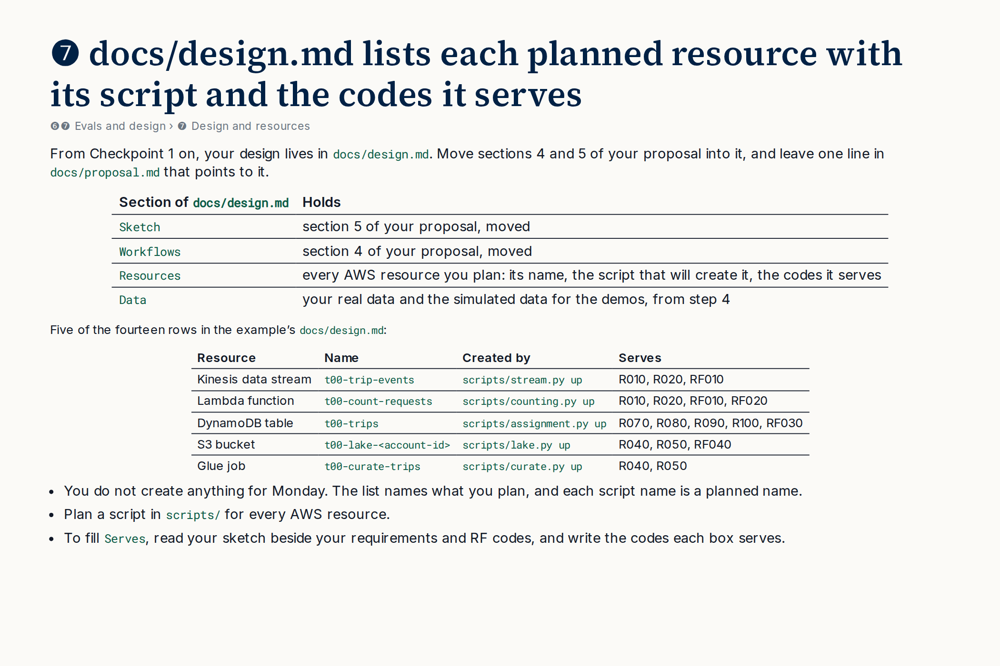
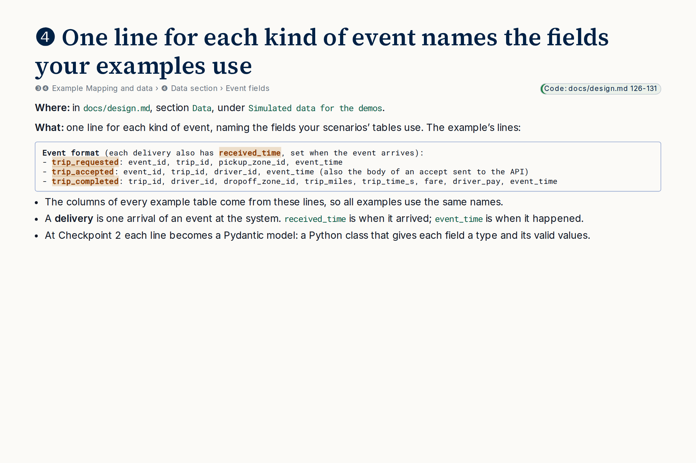
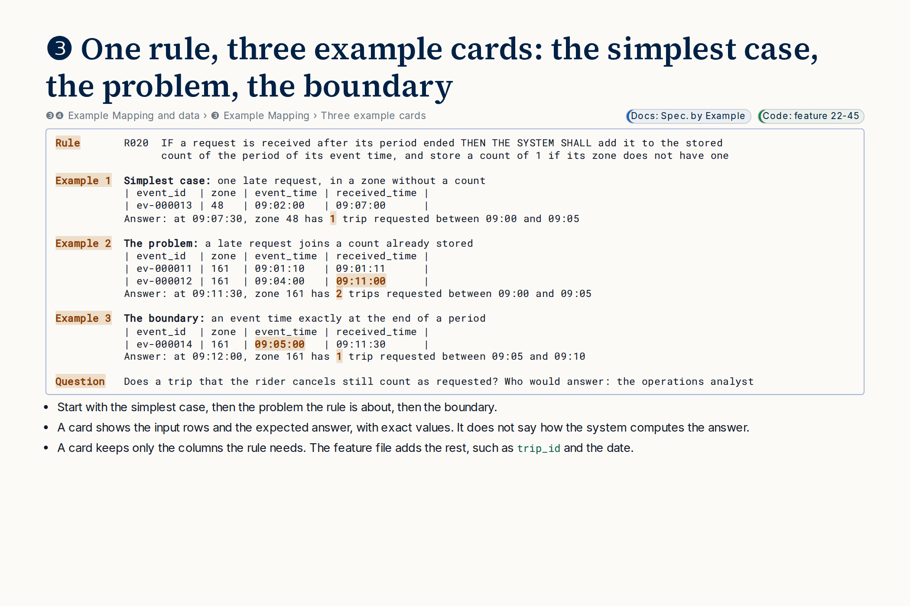
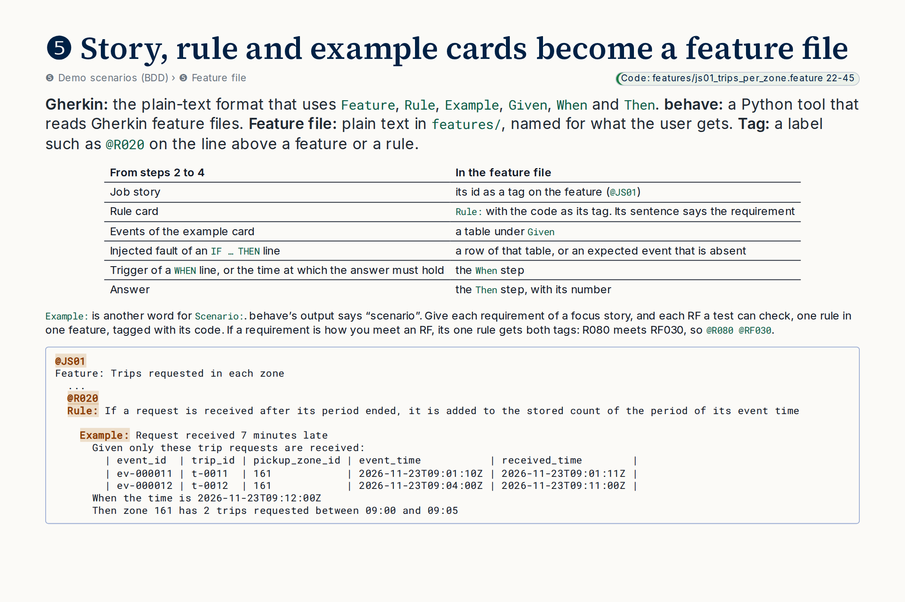
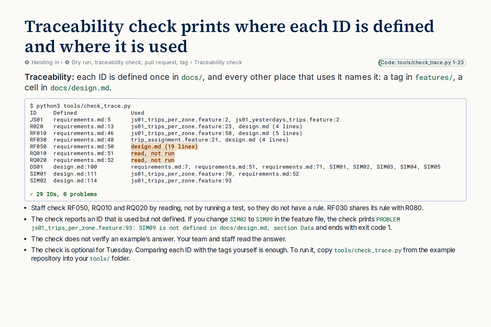
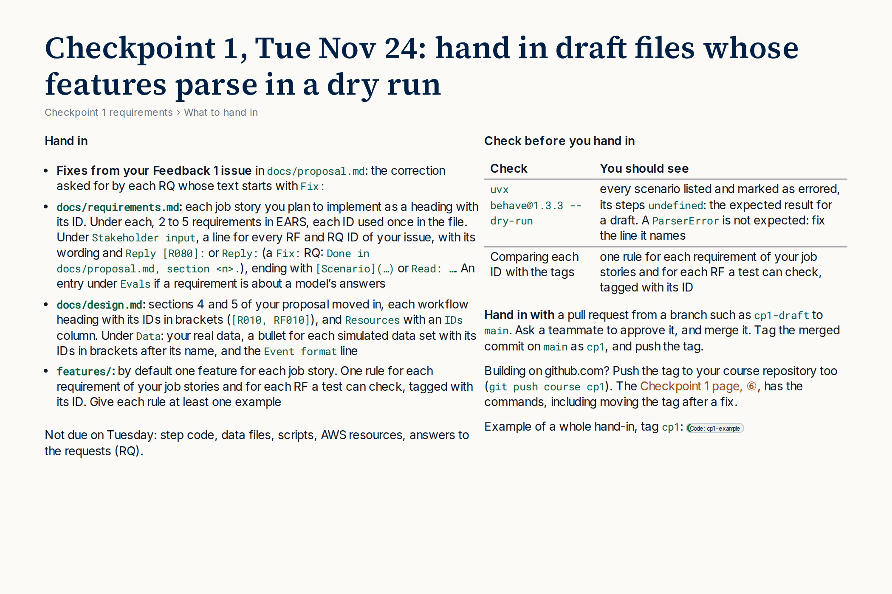

```{=html}
<style>pre, pre code { white-space: pre; overflow-x: auto; }</style>
```

In this checkpoint, you make the corrections that the proposal feedback issue asks for, write your requirements and your
design, and draft the behave scenarios that will test them. You do not write step code or scripts, generate data
files, create AWS resources or answer the requests (RQ) for it. The checkpoint is due **[Tuesday 24 November, end of
day]{.chg}**. You hand it in with a pull request from a branch such as `cp1-draft` to `main`. A teammate approves it, you
merge it, and you tag the merged commit on `main` as `cp1`.

There is an [example repository](https://github.com/cpsc436c-2026w1/cp1-example/tree/cp1) for the Checkpoint 1
submission, showing you the structure and samples of the docs you need to submit at Checkpoint 1. Explore its
`docs/` and `features/` folders. You can reasonably deviate from the example, as long as all requirements from this
page are satisfied. The examples below are from the rides case of the lectures: a ride-hailing app in New York.

```{=html}
<style>.callout-tip pre.markdown code{white-space:pre-wrap;word-break:break-word}</style>
<style>pre.nt-ex{font-family:SFMono-Regular,Menlo,Monaco,Consolas,"Liberation Mono","Courier New",monospace;font-size:.875em;line-height:1.4;color:rgb(0,59,79);background-color:rgba(233,236,239,.65);border:1px solid rgba(233,236,239,.65);border-radius:0;padding:5.355px 5.355px 5.355px 0;margin:1em 0;white-space:pre;overflow-x:visible}pre.nt-ex code{font-size:.85em;padding:.125rem .25rem;color:inherit;background:transparent;white-space:pre-wrap;word-break:break-word}pre.nt-ex em{font-style:italic;text-decoration:none}</style>
```

## What changes in your repository {#repo}

The [example repository](https://github.com/cpsc436c-2026w1/cp1-example/tree/cp1) at tag `cp1` is a whole Checkpoint 1 hand-in, written for the rides
case. Each file name below links to it in that state. Two of its feature files are not shown:
[js04_pickup_place.feature](https://github.com/cpsc436c-2026w1/cp1-example/blob/cp1/features/js04_pickup_place.feature) and
[trip_assignment.feature](https://github.com/cpsc436c-2026w1/cp1-example/blob/cp1/features/trip_assignment.feature).

```{=html}
<style>
.repo-tab { width: 100%; border-collapse: collapse; font-size: 0.9em; margin: 0.6em 0 0.3em; }
.repo-tab td { padding: 0.18em 0.5em; vertical-align: top; border-bottom: 1px solid #eee; }
.repo-tab td.t { font-family: SFMono-Regular, Menlo, Consolas, monospace; white-space: nowrap; font-size: 0.92em; }
.repo-tab td.t a { color: #1f4e8c; text-decoration: underline; }
.repo-tab .add, .repo-legend .add { background: #d9f2df; color: #14532d; font-weight: 600; padding: 0 0.35em; border-radius: 3px; white-space: nowrap; }
.repo-tab .fill, .repo-legend .fill { background: #fff1c2; color: #6b4b00; font-weight: 600; padding: 0 0.35em; border-radius: 3px; white-space: nowrap; }
.repo-tab .chg, .repo-legend .chg { background: #fde2e1; color: #8a1c14; font-weight: 600; padding: 0 0.35em; border-radius: 3px; white-space: nowrap; }
</style>
<table class="repo-tab">
<tr><td class="t">your-repository/</td><td><span class="add">add</span></td><td>tag <code>cp1</code> on <code>main</code>, after your pull request is merged</td></tr>
<tr><td class="t">├── docs/</td><td></td><td></td></tr>
<tr><td class="t">│&nbsp;&nbsp;&nbsp;├── <a href="https://github.com/cpsc436c-2026w1/cp1-example/blob/cp1/docs/proposal.md">proposal.md</a></td><td><span class="chg">change</span></td><td>the corrections asked for by <b>Fix:</b> requests</td></tr>
<tr><td class="t">│&nbsp;&nbsp;&nbsp;├── <a href="https://github.com/cpsc436c-2026w1/cp1-example/blob/cp1/docs/requirements.md">requirements.md</a></td><td><span class="fill">fill in</span></td><td>job stories with their requirements, and the Stakeholder input section</td></tr>
<tr><td class="t">│&nbsp;&nbsp;&nbsp;└── <a href="https://github.com/cpsc436c-2026w1/cp1-example/blob/cp1/docs/design.md">design.md</a></td><td><span class="fill">fill in</span></td><td>sketch, workflows, planned resources, Data</td></tr>
<tr><td class="t">└── features/</td><td></td><td></td></tr>
<tr><td class="t">&nbsp;&nbsp;&nbsp;&nbsp;├── <a href="https://github.com/cpsc436c-2026w1/cp1-example/blob/cp1/features/js01_trips_per_zone.feature">js01_trips_per_zone.feature</a></td><td><span class="add">add</span></td><td>feature files: rules tagged with IDs, examples; by default one feature file for each job story (the example has four; two are shown)</td></tr>
<tr><td class="t">&nbsp;&nbsp;&nbsp;&nbsp;├── <a href="https://github.com/cpsc436c-2026w1/cp1-example/blob/cp1/features/js01_yesterdays_trips.feature">js01_yesterdays_trips.feature</a></td><td><span class="add">add</span></td><td></td></tr>
<tr><td class="t">&nbsp;&nbsp;&nbsp;&nbsp;└── <a href="https://github.com/cpsc436c-2026w1/cp1-example/tree/cp1/features/steps">steps/.gitkeep</a></td><td><span class="add">add</span></td><td>empty for now: step code comes at Checkpoint 2</td></tr>
</table>
```

| File | Kiro keeps the same thing in | Traceability |
|---|---|---|
| `docs/requirements.md` | `requirements.md`: stories with acceptance criteria in EARS | defines unique ids for job stories and requirements (JS01, R010, RF010, RQ010) |
| `docs/design.md` | `design.md`: architecture | names the IDs each workflow and simulated data set serves in brackets after its name (`[R010, RF010]`), and each resource's IDs in its `IDs` column |
| `features/*.feature` | — | tags: `@JS01` on a feature, `@R010` or `@RF010` on a rule |

: {tbl-colwidths="[26,46,28]"}

**`docs/` says what you will build, `features/` says how you demonstrate it works.**

## Checklist

- ① [Make the corrections I asked for in the proposal feedback issue](#fixes).
- ② [Write docs/requirements.md](#requirements).
- ③ [Create docs/design.md](#design).
- ④ [Draft your scenarios in features/](#scenarios).
- ⑤ [Check the scenarios](#dry-run).
- ⑥ [Hand in with a pull request and the tag cp1](#hand-in).

The minimum for Tuesday is small: the corrections that your `Fix:` requests ask for, 1 or 2 job stories with 2 to 5
requirements each, the RF and RQ IDs of the proposal feedback issue, your design with sections 4 and 5 of your proposal moved in, its list of planned resources and its `## Data`
section, and at least one example for each rule.

## ① Make the corrections I asked for in the proposal feedback issue {#fixes}

**In the example repo:** [docs/proposal.md](https://github.com/cpsc436c-2026w1/cp1-example/blob/cp1/docs/proposal.md).

In your `staff-feedback` issue, among the constraints (RF010, RF020 …) and requests (RQ010, RQ020 …), some RQs
start with **Fix:**. Each of them asks for a correction to your `docs/proposal.md` that you complete for Checkpoint 1.

We discuss what to do with all other RQs and RFs in the [next step](#codes). Briefly: for each other RQ, you give me
a short response in Checkpoint 1 on how you would reply to it; the actual solution waits until Checkpoint 2.

If something in the issue does not match what your proposal says, reply in the issue.

::: {.callout-note collapse="true" title="Guidelines: Feedback Triage"}
{fig-alt="L19 slide: From Feedback to Checkpoint 1: triage"}
:::

::: {.callout-tip collapse="true" title="Typical feedback from the Studio: corrections"}
**Problem: A `Fix:` request is done in the proposal, but is not mentioned in `docs/requirements.md`.** It *must* be listed under
`## Stakeholder input`, see example below:

```{=html}
<pre class="nt-ex"><code># Not this
(RQ030 fixed in docs/proposal.md, <em>and no line for it</em>)
# This
- **RQ030** Fix: Say who the user of JS02 is. Done in docs/proposal.md, section 2.</code></pre>
```

**Problem: you spend time on addressing non-Fix RQ and RF's before checkpoint 1.** You don't have to do that and I need you
alive (at least till the final!).

In the example below, DS01 is the data set named in `docs/design.md`, section Data, and Q050 is a row of
`## Assumptions` in `docs/requirements.md`.

```{=html}
<pre class="nt-ex"><code># Not this
docs/design.md <em>gets a new section "Cost" with the cost of one year in CAD</em> (RQ010)
# This
- **RQ010** Choose a meaningful long-term horizon for your system, for example 3 months, 6 months or a year, and calculate what your cloud architecture costs to run over it, in CAD, using the course price sheet. Reply: We will calculate the cost of one year in CAD, based on the completed trips a day in DS01 (*measured*), one request for each of them (*assumed*, Q050) and the course price sheet: processing the stream in Lambda, DynamoDB write units, and the Athena data scanned for the counts. Read at Checkpoint 2: `docs/design.md`, section Cost.</code></pre>
```
:::

## ② Write docs/requirements.md {#requirements}

**In the example repo:** [docs/requirements.md](https://github.com/cpsc436c-2026w1/cp1-example/blob/cp1/docs/requirements.md).

The file should have a heading for each job story you plan to implement, with your requirements (R010 …) as lines
under it, and a section `## Stakeholder input`, with a line for every RF and RQ ID from the proposal feedback
issue. Add the sections `## Evals` and `## Assumptions`, described below, when you need them.

### Job stories and requirements

**In the example repo:** [docs/requirements.md, JS01 to JS04](https://github.com/cpsc436c-2026w1/cp1-example/blob/cp1/docs/requirements.md?plain=1#L5-L40).

1. Copy each job story from your proposal you are actually planning to implement, as a heading with its id:
   `## JS01 <user>: <title>`. You can slightly refine it if needed.
2. Under each job story, write 2 to 5 requirements, one line each, in EARS form. Give requirements unique ids in your project:
   R010, R020 … (not duplicating for each JS).
3. In [④](#scenarios) you will link each requirement to its BDD feature file. You can add a placeholder now, e.g.: `[Scenario](../features/js01_trips_per_zone.feature)`.
   A `[Scenario]` link points to a feature file; in ④ the rule in that file carries the requirement's ID as a tag.
4. If a requirement has a performance target, put it after `|`, with SLO or SLA, for example
   `| data latency under 60 s at p95, from the period's end (SLO)`. The guidelines below explain EARS and targets.
5. Put a requirement that serves two stories under the first one, and name its ID in one sentence under the other
   story.

::: {.callout-note collapse="true" title="Guidelines: Brainstorming Requirements"}
{fig-alt="L19 slide: How EARS writes a requirement"}

{fig-alt="L19 slide: Guiding questions turn a job story into requirements"}

{fig-alt="L19 slide: What can go wrong"}

[EARS](https://alistairmavin.com/ears/) (Easy Approach to Requirements Syntax), with the question each form answers
about your story:

| EARS form | Use it for | Ask about your story |
|---|---|---|
| `WHEN <trigger> THE SYSTEM SHALL <response>` | what the system does when something happens | What must the system do or show, and what starts it? |
| `WHILE <state> THE SYSTEM SHALL <response>` | what holds as long as a state lasts | What is going on while it happens? |
| `IF <problem> THEN THE SYSTEM SHALL <response>` | a problem in your data or your services | What would make the story's outcome false: repeated, late, out of order, missing? |
| `THE SYSTEM SHALL <response>` | what is always true | What must always hold for the outcome? |
| `WHERE <feature> THE SYSTEM SHALL <response>` | behaviour that exists only with your extension | Which behaviour comes with the extension? |

: {tbl-colwidths="[34,30,36]"}

Two openings can be combined: `WHERE <feature>, WHEN <trigger> THE SYSTEM SHALL <response>` is behaviour of your
extension that something starts.

**Performance target after `|`:** data latency or response time at a percentile, as in
[L13](l13.qmd#part-requirements), and what it is measured from. **SLO** is a target your team sets; **SLA** is one
promised to someone outside the team. Example: `| response time under 2 s at p99, from the accept reaching our API (SLO)`.

Here is part of the example's `docs/requirements.md`. Three things help you read it:

- DS01 is a real data set, listed in the `## Data` section of `docs/design.md` (see [③, Data section](#data)). A number
  that comes from a data set names its ID and is marked *measured* or *assumed*. Q040 and Q050 are questions in its
  `## Assumptions` table (see [Making and tracking assumptions](#assumptions)).
- A 5-minute period holds the requests from its start up to, and not including, its end.
- R110 is about the answers of a model: `pickup-place` in it is an eval, a set of test cases for the model's
  answers (see [Testing model answers](#evals)). JS04 was added after the proposal, so its heading says so.

```markdown
## JS01 Operations analyst: trips requested in each zone

When demand moves between zones during the morning rush (837 completed trips in one morning hour in our three zones in DS01,
*measured*, and one request for each, *assumed*, Q050), I want the number of trips requested in each pickup zone for
each 5-minute period, and each morning yesterday's completed trips with a fare above 0 loaded into one table, so that
I can send free drivers where the requests are and query yesterday's fares in that table.

- **R010** WHEN a 5-minute period ends THE SYSTEM SHALL store one count of requested trips for each pickup zone that had a request in the period | data latency under 60 s at p95, from the period's end to the stored count of the requests received by then (SLO) [Scenario](../features/js01_trips_per_zone.feature)
- **R020** IF a request is received after its period ended THEN THE SYSTEM SHALL add it to the stored count of the period of its event time, and store a count of 1 if its zone does not have a count for that period yet | for a request received up to 10 minutes after its event time, data latency under 60 s at p95, from its receipt to the corrected count (SLO) [Scenario](../features/js01_trips_per_zone.feature)
- **R030** THE SYSTEM SHALL show every count with its zone and the start and end of its period [Scenario](../features/js01_trips_per_zone.feature)
```

```markdown
## JS04 Support agent: pickup place of a rider's message (added after the proposal)

When a rider writes to support about a trip (free text, about 200 messages a day, Q040), I want to see the pickup
place that the message names, or that it does not name one, so that I can find the trip without guessing where the
rider was waiting.

- **R110** WHERE the system includes the assistant, WHEN a support agent opens a rider's message THE SYSTEM SHALL show the pickup place that the message names, as a name from our list of places, or say that the message names no pickup place | eval `pickup-place`: at least 10 cases, each run 3 times, and the pickup place is correct in at least 80% of the runs (24 of 30 runs for 10 cases) [Scenario](../features/js04_pickup_place.feature)
- **R120** IF a rider's message names more than one pickup place THEN THE SYSTEM SHALL say that the message names more than one pickup place, and not show any of them as the pickup place [Scenario](../features/js04_pickup_place.feature)
```
:::

### Put every RF and RQ from feedback into docs/requirements.md {#codes}

**In the example repo:** [docs/requirements.md, Stakeholder input](https://github.com/cpsc436c-2026w1/cp1-example/blob/cp1/docs/requirements.md?plain=1#L42-L52).

In a section `## Stakeholder input`, add one line for every RF and RQ ID of the proposal feedback issue, with its
ID and its wording, in the same list format as your requirements. RF and RQ IDs keep the numbers of the issue. What each kind of item needs for Checkpoint 1:

| From the proposal feedback issue, or written by your team | What to do for Checkpoint 1 |
|---|---|
| **Requirement** (R010 …) or **constraint** (RF010 …) that a test can check | `docs/requirements.md`: a requirement under its job story, a constraint in `## Stakeholder input`, each line ending with `[Scenario](…)`. `features/`: BDD test scenarios, tagging requirements (`@R010`, `@RF010`) and adding at least one example |
| **Constraint** we can't test (e.g. which library to use) | `docs/requirements.md`: line ending with a `Read:` note for the course team, or `Read at Checkpoint 2:` when what staff will read does not exist yet |
| **Request** that starts with `Fix:` | `docs/proposal.md`: make the fix. `docs/requirements.md`: say where it was done (`Done in docs/proposal.md, section <n>.`) |
| Any other **request** (RQ …) | `docs/requirements.md`: write a short `Reply:` that says what you will do and what it is based on (`We will calculate … based on …` or `We will write the test …`). You address it at Checkpoint 2 |

: {tbl-colwidths="[38,62]"}

Each line has these parts:

- The ID in bold and the wording of the issue.
- For an RF, `Reply [R080]:` and how your team addresses it, with the R IDs that meet it in brackets (`Reply:` when no R line meets it). For an RQ, `Reply:` and what you will do and what it is based on (`We will calculate … based on …` or `We will write the test …`); for a `Fix:`
  RQ, `Done in docs/proposal.md, section <n>.`
- At the end, `[Scenario](../features/<file>.feature)` with the feature file whose rule carries the ID, when a
  test checks it, or `Read:` with what staff will read, written `Read at Checkpoint 2:` when it does not exist yet. In
  the example, RQ010 ends with `` Read at Checkpoint 2: `docs/design.md`, section Cost. ``; a `Fix:` RQ ends with
  `Done in docs/proposal.md, section <n>.`

::: {.callout-note collapse="true" title="Guidelines: Adding Stakeholder Input (RQ and RF)"}
{fig-alt="L19 slide: Every RF and RQ into docs/requirements.md"}

Here are five lines of the example's `## Stakeholder input` section. `event_id` is the ID of one event, and Q030
is a question in its `## Assumptions` table (see [Making and tracking assumptions](#assumptions)).

```markdown
## Stakeholder input

From the proposal feedback issue, with its IDs and wording.

- **RF010** Every trip request must be counted exactly once, even when the stream delivers its event twice. Reply: the count uses distinct `event_id`; an id is kept for 24 hours (Q030). [Scenario](../features/js01_trips_per_zone.feature)
- **RF030** Say what happens when two drivers accept the same trip at the same moment, and show it. Reply [R080]: the write that assigns a trip has a condition: the trip is not assigned yet. [Scenario](../features/trip_assignment.feature)
- **RF050** Every AWS resource carries the course tags. Reply: each script in `scripts/` tags what it creates. Read at Checkpoint 2: `scripts/` and the tags on the resources.
- **RQ010** Choose a meaningful long-term horizon for your system, for example 3 months, 6 months or a year, and calculate what your cloud architecture costs to run over it, in CAD, using the course price sheet. Reply: We will calculate the cost of one year in CAD, based on the completed trips a day in DS01 (*measured*), one request for each of them (*assumed*, Q050) and the course price sheet: processing the stream in Lambda, DynamoDB write units, and the Athena data scanned for the counts. Read at Checkpoint 2: `docs/design.md`, section Cost.
- **RQ020** Analyze your data latency against changes in your replay speed. Reply: We will write the test that replays SIM01 at 1, 10 and 50 times its speed and checks R010's data latency at each speed. Read at Checkpoint 2: `docs/design.md`, section Experiments, with the test's results.
```

- `[Scenario](…)` at the end of a line links the feature file whose rule carries the ID: staff run that rule.
  `Read: …` or `Read at Checkpoint 2: …` names what staff will read instead. Staff check every line at Checkpoint 2.
- The `[Scenario](…)` links keep your requirements traceable. Turn them into shared agent instructions
  (`AGENTS.md`) and CI checks, such as the dry run on every pull request, to keep your design consistent; this is
  encouraged, not due Tuesday. They are also how we track your progress on our feedback.
:::

### Testing model answers {#evals}

**In the example repo:** [docs/requirements.md, Evals](https://github.com/cpsc436c-2026w1/cp1-example/blob/cp1/docs/requirements.md?plain=1#L54-L61).

If a requirement is about a model's answers, write an entry for its **eval** in a section `## Evals`, with:

1. **Cases:** at least 10, each with its reference value, and the file that holds them.
2. **Correct when (checked by code):** what a reply must be to count as correct, in terms that code can check.
3. **Runs:** each case 3 times, because the model's replies vary from run to run.
4. **Passes when:** correct in at least N of the runs, so that accuracy is at least 80% (24 of 30 runs for 10
   cases).
5. **Model in use:** the model and how the system reaches it.

The example's entry:

```markdown
## Evals

- **pickup-place**, for R110 [Scenario](../features/js04_pickup_place.feature)
  - Cases: 10 rider messages written by the team, each with its reference value: 7 that name a pickup place, 3 that do not (one of them names only a destination). File `evals/pickup_place/cases.jsonl`; our list of places is `evals/pickup_place/places.txt`.
  - Correct when (checked by code): the reply is a JSON object with one field, `pickup_place`, and its value equals the reference value. A reply with text around the JSON or with another field is not correct.
  - Runs: each case 3 times, 30 runs, because the model's replies vary from run to run.
  - Passes when: the pickup place is correct in at least 24 of the 30 runs (accuracy at least 80%).
  - Model in use: Qwen 3.8 27B (`qwen3.8-27b`) through the course LLM gateway.
```

In [④](#eval-features) we show how to define features for evals.

### Making and tracking assumptions {#assumptions}

**In the example repo:** [docs/requirements.md, Assumptions](https://github.com/cpsc436c-2026w1/cp1-example/blob/cp1/docs/requirements.md?plain=1#L63-L71).

When your case does not say something that a requirement depends on, add a row to a section `## Assumptions`:
the question with an ID (Q010, Q020 …; not the RQ IDs of the issue), who would answer it, what you assume, and the
IDs it affects.

::: {.callout-note collapse="true" title="Guidelines: Making and Tracking Assumptions"}
{fig-alt="L19 slide: Example Mapping cards, the question card"}

The example's `## Assumptions` table, two of its rows:

```markdown
| Id | What the case does not say | Who would answer | We assume | Affects |
|---|---|---|---|---|
| Q010 | Does a trip that the rider cancels still count as requested? | the operations analyst | yes, the count is of requests | R010, RF010 |
| Q030 | Can the app send an event again more than 24 hours after it first sent it? | the app's team | no: the app's retries end within minutes | RF010 |
```
:::

::: {.callout-tip collapse="true" title="Typical feedback from the Studio: requirements"}
**Problem: your requirement does not have a unique R000-style id, or uses mine (RF00 or RQ00).** It *must* get the next free R ID (RF and RQ IDs come
only from the proposal feedback issue). To find it, read the R IDs already in `docs/requirements.md`. If the requirement is how you meet an RF, write `Reply [<R ID>]:` in the RF's line and then
describe how you address it, see examples below:

```{=html}
<pre class="nt-ex"><code># Not this
- **<em>RF031</em>** IF a driver accepts a trip that is already assigned THEN …
# This
- **R080** IF a driver accepts a trip that is already assigned THEN THE SYSTEM SHALL refuse the accept and leave the trip with its driver | response time under 2 s at p99, from the accept reaching our API to the driver's answer (SLO) [Scenario](../features/trip_assignment.feature)
- **RF030** Say what happens when two drivers accept the same trip at the same moment, and show it. Reply [R080]: the write that assigns a trip has a condition: the trip is not assigned yet. [Scenario](../features/trip_assignment.feature)</code></pre>
```

**Problem: A requirement is not in EARS form: it does not have `THEN`, it says "will" or "should", or a part of the system is
its subject.** It *must* have THE SYSTEM as its subject and SHALL as its verb, see example below:

```{=html}
<pre class="nt-ex"><code># Not this
If the stream sends an event twice, <em>the counter service will</em> ignore it.
# This
IF a trip request is received a second time THEN THE SYSTEM SHALL leave the stored count unchanged.</code></pre>
```

**Problem: A normal request is written as an `IF … THEN` line.** It *must* be a `WHEN` line, because `IF` names what goes wrong,
see examples below:

```{=html}
<pre class="nt-ex"><code># Not this
<em>IF</em> the analyst opens the zone page <em>THEN</em> THE SYSTEM SHALL show the counts.
# This
WHEN the analyst opens the zone page THE SYSTEM SHALL show the counts.
- **R020** IF a request is received after its period ended THEN THE SYSTEM SHALL add it to the stored count of the period of its event time, and store a count of 1 if its zone does not have a count for that period yet | for a request received up to 10 minutes after its event time, data latency under 60 s at p95, from its receipt to the corrected count (SLO) [Scenario](../features/js01_trips_per_zone.feature)</code></pre>
```

**Problem: A response is written so that a test cannot check it.** It *must* say what the system stores or shows, see example
below:

```{=html}
<pre class="nt-ex"><code># Not this
IF a completed trip in the file has a fare that is missing, 0 or negative THEN THE SYSTEM SHALL <em>handle it appropriately</em>.
# This
- **R050** IF a completed trip in the file has a fare that is missing, 0 or negative THEN THE SYSTEM SHALL leave it out of `trips_curated` and write it to table `trips_rejected` with the reason [Scenario](../features/js01_yesterdays_trips.feature)</code></pre>
```

**Problem: A target does not give a percentile, or does not say where the time is measured from.** After `|`, it *must* give the
percentile and what the time is measured from, see example below:

```{=html}
<pre class="nt-ex"><code># Not this
… THE SYSTEM SHALL answer the driver <em>within 2 seconds</em>
# This
- **R070** WHEN a driver accepts a trip that is requested and not assigned THE SYSTEM SHALL assign the trip to that driver | response time under 2 s at p99, from the accept reaching our API to the driver's answer (SLO) [Scenario](../features/trip_assignment.feature)</code></pre>
```

**Problem: An RQ line does not have a reply.** It *must* have a `Reply:` that says what you will do and what it is based on (`We will calculate … based on …` or `We will write the test …`), see example below:

```{=html}
<pre class="nt-ex"><code># Not this
- **RQ010** Choose a meaningful long-term horizon for your system, for example 3 months, 6 months or a year, and calculate what your cloud architecture costs to run over it, in CAD, using the course price sheet.
# This
- **RQ010** Choose a meaningful long-term horizon for your system, for example 3 months, 6 months or a year, and calculate what your cloud architecture costs to run over it, in CAD, using the course price sheet. Reply: We will calculate the cost of one year in CAD, based on the completed trips a day in DS01 (*measured*), one request for each of them (*assumed*, Q050) and the course price sheet: processing the stream in Lambda, DynamoDB write units, and the Athena data scanned for the counts. Read at Checkpoint 2: `docs/design.md`, section Cost.</code></pre>
```

**Problem: An RF with untestable general requirements has a scenario link like the others.** They are often difficult to do correctly and not our focus. When a `Given`/`When`/`Then` cannot fail it,
its line *must* end with `Read: …` (or `Read at Checkpoint 2: …`) and it *must not* get a rule, see example below:

```{=html}
<pre class="nt-ex"><code># Not this
- **RF050** Every AWS resource carries the course tags. <em>[Scenario](../features/resources.feature)</em>
# This
- **RF050** Every AWS resource carries the course tags. Reply: each script in `scripts/` tags what it creates. Read at Checkpoint 2: `scripts/` and the tags on the resources.</code></pre>
```
:::

## ③ Create docs/design.md {#design}

**In the example repo:** [docs/design.md](https://github.com/cpsc436c-2026w1/cp1-example/blob/cp1/docs/design.md) and its sketch [docs/sketch.puml](https://github.com/cpsc436c-2026w1/cp1-example/blob/cp1/docs/sketch.puml).

1. Move sections 4 (data and workflows) and 5 (the sketch) of your proposal into `docs/design.md`, and clean them
   up where the proposal feedback issue asks. The sketch image moves with section 5: link it from `docs/design.md`.
2. Leave a line in `docs/proposal.md` that points to the new file.
3. Add a section `## Resources`: one row for each AWS resource you plan, with its name, the script in `scripts/`
   that will create it, and the IDs of the requirements and RFs it serves. The scripts and the resources do not exist yet.
4. Add a section `## Data`, described [below](#data), including the simulated data your scenarios need.

::: {.callout-note collapse="true" title="Guidelines: Planned Resources"}
{fig-alt="L19 slide: docs/design.md lists each planned resource"}

The course does not give a template for `docs/design.md`: you write it from sections of your proposal.

Each row of `## Resources` names its script, such as `scripts/stream.py up`; you write the scripts at Checkpoint 2.
For example:

```markdown
| Resource | Name | Created by | IDs |
|---|---|---|---|
| Kinesis data stream | `t00-trip-events` | `scripts/stream.py up` | R010, R020, RF010, RF050 |
| Lambda function | `t00-count-requests` | `scripts/counting.py up` | R010, R020, RF010, RF020, RF050 |
| DynamoDB table | `t00-zone-counts` | `scripts/counting.py up` | R010, R020, R030, RF020, RF050 |
| DynamoDB table | `t00-seen-events` | `scripts/counting.py up` | RF010, RF050 |
```
:::

### Data section {#data}

**In the example repo:** [docs/design.md, Data](https://github.com/cpsc436c-2026w1/cp1-example/blob/cp1/docs/design.md?plain=1#L96-L137).

The `## Data` section has two parts:

1. Write `### Our data`: 3 or 4 sentences on the real data set your system is built on: the subset you use (rows,
   size, time range), where it comes from, and what the system uses it for. Give each data set an ID, such as DS01,
   and mark each number *measured* (you ran a query), *given* (a page of the source states it) or *our choice*.
2. Write `### Simulated data for the demos`: one bullet in words for each simulated data set that your examples
   name, with an ID such as SIM01 and, in brackets after its name, the IDs of the requirements and RFs it shows
   (`- **SIM01 Rush hour** [RF010] …`): what it holds and its injected faults (problems put into the test data on
   purpose) with exact counts. Then write one line for each kind of event,
   naming the fields that your examples' tables use.

Write both parts as text for Tuesday: no file, bucket or generator has to exist.

::: {.callout-note collapse="true" title="Guidelines: Real and Simulated Data"}
{fig-alt="L19 slide: Simulated data and the real data subset"}

{fig-alt="L19 slide: One line of fields for each kind of event"}

The columns of every example table come from the lines of event fields, so all examples use the same names. An
injected fault is not a field of an event, because the system you test must not be told which events are faulty:
the bullet names the faults. At Checkpoint 2 a generator writes the files, and each line of event fields becomes a
Pydantic model with types and valid values.

The example's `Our data`:

```markdown
### Our data

DS01 is the High Volume For-Hire Vehicle trip records of the NYC Taxi and Limousine Commission: one row for each
finished trip, one [Parquet file a month](https://d37ci6vzurychx.cloudfront.net/trip-data/fhvhv_tripdata_2024-03.parquet)
over HTTPS ([trip record page](https://www.nyc.gov/site/tlc/about/tlc-trip-record-data.page)). We use the Uber trips
picked up in Manhattan in March 2024 (*our choice*): 6,045,943 of the month's 21,280,788 rows, 0.20 GB as Parquet
(*measured* 2026-11-19, DuckDB). DS02, the TLC [taxi zone lookup](https://d37ci6vzurychx.cloudfront.net/misc/taxi_zone_lookup.csv),
gives the borough and name of each of its 265 zones (*measured* 2026-11-20, DuckDB). The system's events are simulated
from DS01 rows of zones 48, 161 and 230 (*our choice*); each bullet below says which days of DS01 it uses and the
dates they are moved to (*our choice*).
```

Two of the example's five bullets, and its event fields:

```markdown
### Simulated data for the demos

- **SIM01 Rush hour** [RF010] One morning hour from DS01: the 837 trips requested in zones 48, 161 and 230 on
  2024-03-14 between 08:00 and 09:00 New York time, moved to 09:00 to 10:00 UTC on 2026-11-23: 304, 191 and 342
  trips, 2,511 events sent as 2,515 deliveries: 4 requests arrive twice, and 2 arrive 6 to 10 minutes late.
- **SIM02 Quiet zone** [RF020] SIM01's hour from DS01 without its 6 faults, and without the 60 trips of zone 48
  requested between 09:25 and 09:35: 777 trips (244, 191 and 342 in zones 48, 161 and 230), 2,331 events.

**Event format** (each delivery also has `received_time`, set when the event arrives):

- `trip_requested`: `event_id`, `trip_id`, `pickup_zone_id`, `event_time`
- `trip_accepted`: `event_id`, `trip_id`, `driver_id`, `event_time` (also the body of an accept sent to the API)
- `trip_completed`: `trip_id`, `driver_id`, `dropoff_zone_id`, `trip_miles`, `trip_time_s`, `fare`, `driver_pay`,
  `event_time`
```

Use the same ID in the bullet, in the folder `sim/data/SIM01/` that you create at Checkpoint 2, and in the `Given`
of each example that uses the data set.
:::

::: {.callout-tip collapse="true" title="Typical feedback from the Studio: design and data"}
**Problem: Data does not have a line of event fields, and the examples name the same columns differently.** Under Data, each
kind of event *must* have one line of fields, and every example *must* use exactly those names as columns, see example
below:

```{=html}
<pre class="nt-ex"><code># Not this
(examples with columns <em>id, zone, time</em> in one and <em>request_id, zone_id, ts</em> in another)
# This
**Event format** (each delivery also has `received_time`, set when the event arrives):

- `trip_requested`: `event_id`, `trip_id`, `pickup_zone_id`, `event_time`</code></pre>
```

**Problem: A simulated data set does not provide specific numbers, or is not linked to requirements.** It *must* be one
bullet with an ID, the IDs it shows in brackets after its name, and exact numbers: its size and the count of each
injected fault (a problem the simulator adds to the data on purpose, and records, so the test knows the right answer),
see example below:

```{=html}
<pre class="nt-ex"><code># Not this
- <em>Rush hour data</em> with <em>some duplicates</em> and <em>some late events</em>.
# This
- **SIM01 Rush hour** [RF010] One morning hour from DS01: the 837 trips requested in
  zones 48, 161 and 230 on 2024-03-14 between 08:00 and 09:00 New York time, moved to
  09:00 to 10:00 UTC on 2026-11-23: 304, 191 and 342 trips, 2,511 events
  sent as 2,515 deliveries: 4 requests arrive twice, and 2 arrive 6 to 10 minutes late.</code></pre>
```
:::

## ④ Draft your scenarios in features/ {#scenarios}

**In the example repo:** [features/](https://github.com/cpsc436c-2026w1/cp1-example/tree/cp1/features).

BDD test scenarios are your demos of the system's behaviour: `Given` the data, `When` something happens, `Then` the answer you know before the system runs.

Write the scenarios in Gherkin, in a folder `features/` in your repository:

1. Create one feature file in `features/` for each job story you plan to implement, named for what the user gets,
   and tag its `Feature:` with every job story it serves (`@JS01`).
2. Write one `Rule:` for each requirement and for each RF that a test can check, tagged with its ID (`@R010`,
   `@RF010`). Each ID is one rule in one feature file. RQ IDs, and RF IDs whose line ends with `Read:` or `Read at Checkpoint 2:`, do not get a
   rule.
3. Put an RF rule in the feature file of the job story that the constraint is about. When one of your requirements
   is how you meet the constraint, write one rule with both IDs.
4. Write at least one `Example:` under each rule, with an answer that you know before the system runs, and a few
   events in a table with the event fields of your `## Data` section as columns, or name a simulated data set by
   its ID. Your examples demonstrate the critical functionality, requirements and technical constraints, not all of
   the system's behaviour. A rule can have three kinds of example:
   - a **success case**: the rule working on ordinary input; `Given` the input rows, `Then` the correct answer,
     calculated beforehand;
   - a **problem**: an example that demonstrates a property of your system, such as how it handles a late or a
     duplicate event;
   - a **boundary**: what your system does at a limit of its design or technology, such as an event exactly at the
     end of a period.

   The minimum is one example for each rule; add a problem or a boundary where the rule has one. To demonstrate
   problems and boundaries with many events, you generate data with the failures in it:
   [tutorial B5T2](https://github.com/cpsc436c-2026w1/b5-t2-behave-sim).
5. For a requirement on a model's answers, add one **gate example** to its rule: an example tagged `@eval` that
   names the eval of your `## Evals` section (see [Features for evals](#eval-features)).

::: {.callout-note collapse="true" title="Guidelines: From Example Mapping to Feature Files"}
{fig-alt="L19 slide: Example Mapping cards"}

{fig-alt="L19 slide: One rule, three example cards"}

{fig-alt="L19 slide: Cards become a feature file"}

- A feature file can serve two job stories: `@JS02 @JS03` when two users read the same thing.
- When one of your own requirements is how you meet a constraint, its rule carries both IDs: in the example, R080
  (refuse the second accept of a trip) meets RF030 (two drivers accept the same trip), so its rule is tagged
  `@R080 @RF030`.
- When the number of events matters, such as a whole hour, name a simulated data set by its ID and name:
  `Given the simulated data set SIM01 "rush-hour"`.

Here is part of the example's `features/js01_trips_per_zone.feature`. Its table columns are fields of the
events: `event_id` (one ID for one event), `trip_id`, `pickup_zone_id`, `event_time` (when the rider asked) and
`received_time` (when the event reached the system).

```gherkin
@JS01
Feature: Trips requested in each zone
  Covers the first part of JS01 (operations analyst): the number of trips requested in each pickup zone for each
  5-minute period. A period holds the requests with an event time from its start up to, and not including, its end.
  A table holds the only events of its example. Its columns are event fields listed in docs/design.md,
  section Data. A simulated data set is named by its id and described in the same section, under Simulated data
  for the demos.

  @R010
  Rule: When a 5-minute period ends, one count of requested trips is stored for each pickup zone that had a request

    Example: Three requests in one period
      Given only these trip requests are received:
        | event_id  | trip_id | pickup_zone_id | event_time           | received_time        |
        | ev-000001 | t-0001  | 161            | 2026-11-23T09:01:10Z | 2026-11-23T09:01:11Z |
        | ev-000002 | t-0002  | 161            | 2026-11-23T09:03:40Z | 2026-11-23T09:03:41Z |
        | ev-000003 | t-0003  | 230            | 2026-11-23T09:04:58Z | 2026-11-23T09:04:59Z |
      When the period between 09:00 and 09:05 ends
      Then within 30 s zone 161 has 2 trips requested between 09:00 and 09:05
      And within 30 s zone 230 has 1 trip requested between 09:00 and 09:05

  # (rules R020 and R030 of the file are left out here)

  @RF010
  Rule: Every trip request is counted exactly once, even when the stream delivers its event twice

    Example: One request delivered twice
      Given only these trip requests are received:
        | event_id  | trip_id | pickup_zone_id | event_time           | received_time        |
        | ev-000101 | t-0101  | 161            | 2026-11-23T09:11:00Z | 2026-11-23T09:11:01Z |
        | ev-000102 | t-0102  | 161            | 2026-11-23T09:12:30Z | 2026-11-23T09:12:31Z |
        | ev-000101 | t-0101  | 161            | 2026-11-23T09:11:00Z | 2026-11-23T09:12:40Z |
      When the counts are read at 2026-11-23T09:15:30Z
      Then zone 161 shows 2 trips requested between 09:10 and 09:15

    # (the second example of RF010, with SIM01, is left out here)

    # Replay limit: a second delivery up to 24 hours after the first is not counted. We assume the app does not
    # send an event again after that (Q030).
    # Question (Q010): does a trip that the rider cancels still count as requested?
```

The `Then` checks one case of the requirement's target: R010 asks for data latency under 60 s at p95 after the period's end, so one example checks that its count is there within 30 s, inside that target. The percentile is over many periods, which a single example cannot show.
The times in an example are data; nobody waits for them. A line that starts with `#` is a comment, which behave
does not read: `# Question (Q010)` puts the open question of your `## Assumptions` table beside the rule that
depends on it.

The guide [Behave for your project](project-behave.qmd#level-0) shows how each EARS form becomes a rule and its
examples, and how to read the dry run's output.
:::

### Features for evals {#eval-features}

**In the example repo:** [features/js04_pickup_place.feature](https://github.com/cpsc436c-2026w1/cp1-example/blob/cp1/features/js04_pickup_place.feature).

For a requirement on a model's answers, add one **gate example** to its rule: an example tagged `@eval` whose
steps name the eval of your `## Evals` section, its number of cases, the runs of each case, and how many runs must
be correct. Beside it, write ordinary examples, each with one input and the answer that the rule allows. Here is
the example's whole `features/js04_pickup_place.feature`:

```gherkin
@JS04 @assistant
Feature: Pickup place of a rider's message
  Covers JS04 (support agent) in a system that includes the assistant, our extension. The assistant sends the
  rider's message to the model as the user message; the output format is a JSON object with one field,
  pickup_place: a name from evals/pickup_place/places.txt, null when the message names no pickup place, or
  "more than one" when it names more than one.
  Step code: this example repository has step code for this feature only, to show how an LLM eval runs in behave.
  You do not write step code for Checkpoint 1.

  @R110
  Rule: Where the system includes the assistant, a rider's message is shown with the pickup place it names, or the system says that it names no pickup place

    Example: Message that names a pickup place
      Given the rider message "I'm waiting outside JFK Terminal 4, door 6. Where is my driver?"
      When the support agent opens the message
      Then the pickup place is "JFK Terminal 4"

    Example: Message that names only a destination
      Given the rider message "Take me to Penn Station. I haven't decided where to be picked up yet."
      When the support agent opens the message
      Then the system says that the message names no pickup place

    @eval
    Example: Eval of pickup places
      Given the 10 cases of the eval "pickup-place"
      When the model that the system uses answers each case 3 times
      Then the pickup place is correct in at least 24 of the 30 runs

  @R120
  Rule: If a rider's message names more than one pickup place, the system says so and does not show any of them as the pickup place

    Example: Message that names two pickup places
      Given the rider message "Pick me up at Penn Station or at Grand Central Terminal, whichever is faster for the driver."
      When the support agent opens the message
      Then the system says that the message names more than one pickup place
```

The example repo has step code for this feature only, to demonstrate LLM evals. You do not write step code for
Checkpoint 1.

::: {.callout-note collapse="true" title="Guidelines: Testing Model Answers"}
{fig-alt="L19 slide: Eval in words"}

If your system includes a model, its answer can differ between runs, so one example with a fixed reply does not
show the requirement. An **eval** runs the model's part of your system on a set of cases with known answers, each
case several times, and counts the runs with a correct answer. The gate example fails when fewer runs are correct
than the number in its `Then`. Choose that number from the cases and runs: 10 cases run 3 times are 30 runs, and
80% of 30 is 24.
:::

::: {.callout-tip collapse="true" title="Typical feedback from the Studio: scenarios"}
**Problem: A testable RF has a line in `docs/requirements.md` but does not have a rule in `features/`, the most common gap.**
It *must* get a rule tagged with its ID and at least one example, and its line *must* end with `[Scenario](…)`, see
example below:

```{=html}
<pre class="nt-ex"><code># Not this: RF010 appears <em>only in docs/requirements.md</em>.
# This
@RF010
Rule: Every trip request is counted exactly once, even when the stream delivers its event twice

  Example: One request delivered twice
    Given only these trip requests are received:
      | event_id  | trip_id | pickup_zone_id | event_time           | received_time        |
      | ev-000101 | t-0101  | 161            | 2026-11-23T09:11:00Z | 2026-11-23T09:11:01Z |
      | ev-000102 | t-0102  | 161            | 2026-11-23T09:12:30Z | 2026-11-23T09:12:31Z |
      | ev-000101 | t-0101  | 161            | 2026-11-23T09:11:00Z | 2026-11-23T09:12:40Z |
    When the counts are read at 2026-11-23T09:15:30Z
    Then zone 161 shows 2 trips requested between 09:10 and 09:15</code></pre>
```

The `RF010` line in `docs/requirements.md` then ends with `[Scenario](../features/js01_trips_per_zone.feature)`.

**Problem: An example is written in prose, without rows.** It *must* give the event rows needed to establish the answer, with
the event fields of Data as columns, plus the delivery field `received_time` (one request needs one row; a request delivered twice needs two delivery rows
with the same `event_id`), see example below:

```{=html}
<pre class="nt-ex"><code># Not this
Given <em>a few requests in zone 161, one of them sent twice</em>
# This
Given only these trip requests are received:
  | event_id  | trip_id | pickup_zone_id | event_time           | received_time        |
  | ev-000101 | t-0101  | 161            | 2026-11-23T09:11:00Z | 2026-11-23T09:11:01Z |
  | ev-000101 | t-0101  | 161            | 2026-11-23T09:11:00Z | 2026-11-23T09:12:40Z |</code></pre>
```

**Problem: A `Then` does not give an exact value, or an example does not say when the count is read.** The answer *must* be
worked out from the rows before the system runs (the two rows above are one request delivered twice, so the count is
1), see example below:

```{=html}
<pre class="nt-ex"><code># Not this
Then the system shows <em>the right count</em>
# This
When the counts are read at 2026-11-23T09:15:30Z
Then zone 161 shows 1 trip requested between 09:10 and 09:15</code></pre>
```

**Problem: A rule has an example for the simplest case only.** Each rule *must* have at least one example. If the requirement has a
boundary, add an example exactly at that boundary. The examples of an `IF` requirement *must* go under its own
rule, see examples below:

```gherkin
# R010: simplest case
Example: Three requests in one period
# R020: the problem, then the boundary
Example: Request received 7 minutes late
Example: Late request at the boundary goes to the period it starts
```

**Problem: Example Mapping cards are pasted as they are.** They *must* be typed as `Feature`, `Rule`, `Example`, `Given`,
`When`, `Then`, and checked with `uvx behave@1.3.3 --dry-run`.

**Problem: You put all data for an example requiring many rows into a scenario table.** Scenario tables reflect a group
of single separate cases. Data fixtures you need for a test should be in JSONL or Parquet files, structured as in the
example below. You should only describe them in Checkpoint 1, we will simulate them later.

Rows under `Given` are the inputs of one example. When an example needs many rows, a simulated data set holds them.

```{=html}
<pre class="nt-ex"><code># Not this: <em>a table with the 40 requests of one period</em>
# This, in the feature file
Given the simulated data set SIM01 "rush-hour"
# and in docs/design.md, section Data
- **SIM01 Rush hour** [RF010] One morning hour from DS01: the 837 trips requested in
  zones 48, 161 and 230 on 2024-03-14 between 08:00 and 09:00 New York time, moved to
  09:00 to 10:00 UTC on 2026-11-23: 304, 191 and 342 trips, 2,511 events
  sent as 2,515 deliveries: 4 requests arrive twice, and 2 arrive 6 to 10 minutes late.
# At Checkpoint 2 its files are in sim/data/SIM01/</code></pre>
```

**Problem: A rule is tagged with an ID that is not in `docs/requirements.md`.** Each rule *must* be tagged with its requirement's
ID (`@R010`), and an RF tag *must* be added only for an RF of your issue. Compare every rule tag in `features/` with the IDs in
`docs/requirements.md` (step 3 of [⑤](#dry-run)).

**Problem: For a model's answer, the answer is already in the input rows.** `Given` *must* keep only what the system receives,
and the answer you expect *must* go in `Then`, see example below:

```{=html}
<pre class="nt-ex"><code># Not this: the rows already say what the model should find
Given these rider messages:
  | message                               | <em>pickup_place</em>   |
  | I'm outside JFK Terminal 4, door 6    | <em>JFK Terminal 4</em> |
# This: the message only, and the answer in Then
Given the rider message "I'm outside JFK Terminal 4, door 6"
When the support agent opens the message
Then the pickup place is "JFK Terminal 4"</code></pre>
```
:::

## ⑤ Check the scenarios {#dry-run}

**In the example repo:** [DEMO.md, Checkpoint 1](https://github.com/cpsc436c-2026w1/cp1-example/blob/cp1/DEMO.md?plain=1#L9-L94) (the dry run and its output).

1. Create the folder `features/steps/` with an empty file in it:

   ```default
   mkdir -p features/steps
   touch features/steps/.gitkeep
   ```

2. In a terminal at the root of your repository, run the dry run:

   ```default
   uvx behave@1.3.3 --dry-run
   ```

   The command exits with code 1 because step code is not written yet. Check that it lists every feature file
   without a `ParserError` and that its `rules` count matches your `Rule:` lines. If a `ParserError` appears, fix
   the line behave names.

3. Read each ID in `docs/requirements.md` against the tags in `features/`: every requirement and every RF that a
   test can check has one rule tagged with its ID.

::: {.callout-note collapse="true" title="Guidelines: Dry Run and Traceability Check"}
{fig-alt="L19 slide: Dry run before the pull request and the tag"}

{fig-alt="L19 slide: Traceability check"}

behave looks for step code in a folder `features/steps/`, even on a dry run; the empty file makes git keep the
folder. The version of behave is pinned because older versions of behave do not read `Rule:`: behave 1.2.6 stops
with a `ParserError` at the first `Rule:` line of the example.

You should see your features and examples listed, each example marked as errored, then summary lines. For the four
feature files of the example they are:

```default
0 features passed, 0 failed, 3 error, 0 skipped, 1 untested
0 rules passed, 0 failed, 12 error, 0 skipped, 2 untested
0 scenarios passed, 0 failed, 18 error, 0 skipped, 4 untested
0 steps passed, 0 failed, 0 skipped, 73 undefined, 11 untested
```

At this checkpoint that is the expected result: the examples error and the steps are undefined because they do not
have step code yet, and the command ends with exit code 1 for the same reason. The 4 examples of JS04 are
`untested`: the example repo has step code for that feature, and a dry run does not run it. Your team does not write step code
for Checkpoint 1, so you see every example as `error`. The `scenarios` count includes each `Example:`
or `Scenario:` line and each data row of a `Scenario Outline:`.

The dry run does not know your IDs, so the last check is done by reading.
:::

## ⑥ Hand in with a pull request and the tag cp1 {#hand-in}

**In the example repo:** [the tag cp1](https://github.com/cpsc436c-2026w1/cp1-example/tree/cp1/).

Your team hands in through a pull request, under the rules of your `AGENTS.md` and `CONTRIBUTING.md`: no direct
pushes to `main`, one approval from someone other than the author, and no squash merge.

1. Commit `docs/` and `features/` on a branch such as `cp1-draft`. If you build on github.com, first merge your
   course repository's `main` into the branch, so changes merged only on github.students (such as the `AGENTS.md`
   pull request) are in it.
2. Open a pull request from the branch to `main` where you build. In its description, name the IDs it touches
   (JS01, R010, RF010 …).
3. Ask a teammate to approve it. When the teammate has approved it, merge it with a merge commit, not a squash
   merge.
4. Tag the merged commit on `main` as `cp1`, and push the tag to your course repository on github.students.
5. Check on github.students that the tag `cp1` points at the merge commit of your pull request.
6. If you merge another pull request before the deadline, move the tag `cp1` to the new merge commit and push it
   again (see "You fixed something after you tagged" under Typical git problems below).

At Checkpoint 2, the steps of your examples get code, and staff run them against your system. The answers to the
RQs whose text does not start with `Fix:` are due then too.

::: {.callout-note collapse="true" title="Guidelines: Hand-In with a Pull Request and a Tag"}
{fig-alt="L19 slide: Checkpoint 1 hand-in"}

**If you build in your course repository** (github.students, remote `origin`):

From your local device, in your repository's terminal:

```default
git switch -c cp1-draft
git add docs/ features/
git commit -m "Checkpoint 1: requirements and scenarios"
git push -u origin cp1-draft
```

After the pull request is merged on github.students:

```default
git switch main
git pull
git tag cp1
git push origin cp1
```

**If you build on github.com**, your clone needs two remotes: `origin` for github.com and `course` for your course
repository on github.students ([Where you build](project-proposal.qmd#where-you-build)).

From your local device, in your repository's terminal, check them:

```default
git remote -v
```

If `course` is not in the list, add it, with your team's number, and check that it connects:

```default
git remote add course git@github.students.cs.ubc.ca:CPSC436C-2026W-T1/team_NN.git
git ls-remote course
```

github.students works only on a UBC network, on campus or over the [UBC VPN](https://it.ubc.ca/services/email-voice-internet/myvpn), and with the SSH key you added in
[Project startup](project-startup.qmd). If `git ls-remote course` asks for a password or times out, check those two
first. Then:

```default
git switch main
git pull origin main
git switch -c cp1-draft
git fetch course
git merge course/main
git add docs/ features/
git commit -m "Checkpoint 1: requirements and scenarios"
git push -u origin cp1-draft
```

`git merge course/main` brings in what was merged only in your course repository, such as the `AGENTS.md` pull
request. A change your team merged on both hosts has the same content on both sides, so it merges without a
conflict; if git reports one, keep the lines your team wants and commit. Then open the pull request on github.com.
After it is merged there:

```default
git switch main
git pull origin main
git tag cp1
git push origin cp1
git push course cp1
```

A tag carries its commit and the commits before it, so you do not push `main` to github.students. The teaching team
reads your hand-in at the tag `cp1` in your course repository: `git ls-remote course cp1` shows the commit it points
at.
:::

::: {.callout-tip collapse="true" title="Typical git problems"}
These are common problems with this hand-in.

**Problem: You tagged your branch, not the merge commit.** The tag *must* be on the merge commit on `main`, so tag after the
merge and push the moved tag, see the commands below. The `course` line is only for teams that build on github.com,
with a separate `course` remote:

```default
git switch main
git pull origin main
git tag -f cp1
git push -f origin cp1
git push -f course cp1      # if you build on github.com
```

**Problem: You build on github.com and pushed the tag to github.com only.** The tag *must* also be pushed to your course
repository, see the commands below:

```default
git push course cp1
git ls-remote course cp1
```

**Problem: You fixed something after you tagged.** The fix *must* be merged with a pull request and the tag moved to the new
merge commit, see the commands below. The `course` line is only for teams that build on github.com, with a
separate `course` remote:

```default
git switch main
git pull origin main
git tag -f cp1
git push -f origin cp1
git push -f course cp1      # if you build on github.com
```

Without `-f`, git refuses the tag and the push, because the tag already exists.

**Problem: You build on github.com, ran `git push course main`, and git refused it.** Your course repository's `main` has
commits that your github.com `main` does not have, such as the `AGENTS.md` pull request, so git will not overwrite it.
You do not need `main` on github.students: the teaching team reads the tag. Push only the tag, which carries all the
commits of your hand-in, see the commands below:

```default
git push course cp1
git ls-remote course cp1
```

**Problem: Your teammates still see the old tag.** They *must* fetch the moved tag with `git fetch --tags -f`.
:::

## Words used on this page {#words}

- **Job story:** who needs what and why, from your proposal, with an ID such as JS01; on this page, the job stories
  you plan to implement.
- **ID:** a name such as JS01, R010, RF010, RQ010, Q010, DS01 or SIM01, used in headings, lines and tags.
- **RF ID, RQ ID:** an item of the proposal feedback issue. An **RF** (constraint) is a condition that staff added.
  Most can be checked by a test: they get a rule and an example in `features/`. Some cannot, such as which library
  to use: they get a line that ends with a `Read:` or `Read at Checkpoint 2:` note. An **RQ** (request) is something you write and show us, such as a
  calculation or a decision. An RQ that starts with **Fix:** asks for a correction to `docs/proposal.md` for
  Checkpoint 1; any other RQ gets a `Reply:` that says what you will do and what it is based on, and you address it at Checkpoint 2.
- **Feature, rule, example:** a feature file in Gherkin, the plain-text format behave reads, holds rules. A
  **rule** states one requirement. An **example** under it shows the rule with data and a known answer, in steps
  that start with `Given`, `When` and `Then`. behave's output calls an example a scenario. These BDD test
  scenarios are your demos of the system's behaviour.
- **Tag:** a label that starts with `@` on the line above a feature, rule or example, such as `@RF010`. A git tag
  such as `cp1` is a different thing: a name for one commit.
- **Simulated data set:** events or files that your team will generate from a real data set, so that a test knows
  every event that was sent. For Checkpoint 1 a simulated data set is a bullet of words in the `Data` section of
  your design, with an ID such as SIM01; you do not generate it yet.
- **Injected fault:** a problem that simulated data contains on purpose, such as an event that arrives twice. It
  is recorded beside the data, so that the test knows the right answer.
- **Dry run:** behave reads the feature files and lists the steps, without running any code.
