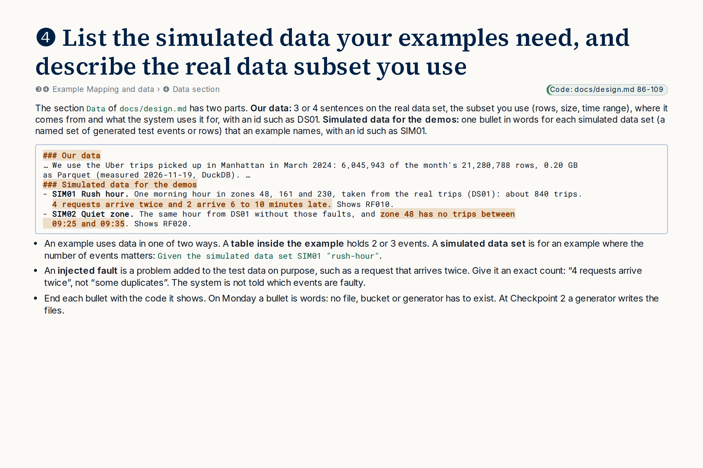
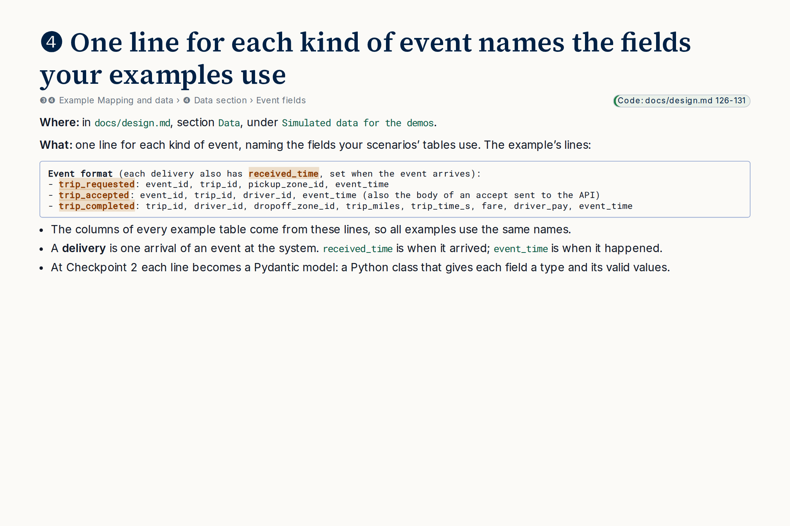
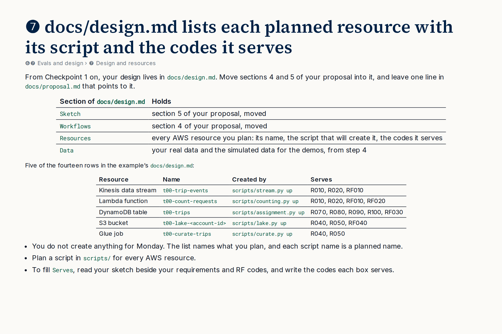

```{=html}
<style>pre, pre code { white-space: pre; overflow-x: auto; }</style>
```

Due **Tuesday 1 December, end of day**, with the tag `cp2`.

For Checkpoint 2, you continue working on demo scenarios, and, hopefully, start building the system.
I will check only a small subset at the deadline, but you now have leases and recipes are available on Wed Nov 25, so
nothing blocks you from creating infrastructure.

What to focus on:

- [①](#guidance-1) **Design and requirement checks:** run the new checks I provided on MCP, especially the budget check, and triage the results.
  - to run a check, connect the course MCP server to your coding assistant ([ilm.wiki/436c/mcp-setup](https://ilm.wiki/436c/mcp-setup))
    and ask it, for example, "Run the budget and sandbox check on our repository." It writes one file in
    `docs/reviews/` and changes nothing else in your repository or your lease; commit that file: it is your check
    report.
  - if you want to work without an LLM assistant, the content of the MCP checks is in the repo [mcp-static-content](https://github.students.cs.ubc.ca/CPSC436C-2026W-T1/mcp-static-content): open your
    milestone's folder and go through its questions by hand.
  - the budget check is important because you don't want to miss something putting you out of budget soon!
  - together with the budget check, consider the RQs I left in your feedback issue: they should help you to plan
    better (but you can hand in the answers after cp2 if you are tight on time).
  - the Checkpoint 2 check is based on the cp2 state I expect to see and on some typical errors I already know about.
  - Remember, your coding assistant's LLM model generates the output, so compare the results across team members, and
    triage. Decisions are on you!
  - I expect to see at least one check report in the repo, and some evidence of triage and decisions in
    `requirements` and `design` made based on the report (changes in both; decision lines go in `requirements`) --
    you don't have to fix everything!
- [②](#guidance-2) **Simulated data and demo scenarios:** generate simulated data and create behave scenarios at least for some of your key job stories and requirements.
  - your choice how to pace yourself before cp2: I expect to see at least (just?) **one JS and a (sub)set of
    requirements for it** at least partially covered at cp2, but realistically it would be good to cover more.
  - use B5T2 as an example, and the guidelines included in MCP if they help to generate data, but essentially, how you
    approach this is largely up to you. I expect to have some test data files available, called and evaluated in
    behave scenarios, and making sense.
  - make sure your sim data used in the behave scenarios is available to us: stored either in the repo or in a public
    S3 bucket, with paths in the behave scenarios; create such a bucket in your S3 account regional namespace (its
    name ends in `-<account-id>-ca-central-1-an`), so that no other account can take or reuse its name.
  - we should be able to do a not-failing dry run on implemented scenario(-s) ([the dry run](#dryrun)).
- [③](#guidance-3) **Implementation:** what you can build is up to you; I would set up at least a very small setup, maybe helping you to run your
  experiment (no report expected yet).
- [④](#guidance-4) **Required updates:** With the tag `cp2`, I expect to see some changes based on the guidance above in `requirements`, `design`, and behave
  scenarios (feature and steps folders), and at least one check report in the repo.
  - You should continue to use issues and PRs in your repo and mention them in your requirements and design docs.
- [⑤](#guidance-5) **Getting ready for the project clinic:** I would also focus on surfacing as many questions and issues as possible before our Dec 3 project clinic, so focus
  on what's uncertain vs what's easy, if you can.
- Everything else on this page should help you to focus on the right things, but you can sensibly change stuff.
- Recipes with the code should be ready by Wed Nov 25 EoD; before that, you can start on checking and updating
  requirements.


```{=html}
<style>.callout-tip pre.markdown code,.callout-note pre.markdown code{white-space:pre-wrap;word-break:break-word}</style>
<style>pre.nt-ex{font-family:SFMono-Regular,Menlo,Monaco,Consolas,"Liberation Mono","Courier New",monospace;font-size:.875em;line-height:1.4;color:rgb(0,59,79);background-color:rgba(233,236,239,.65);border:1px solid rgba(233,236,239,.65);border-radius:0;padding:5.355px 5.355px 5.355px 0;margin:1em 0;white-space:pre;overflow-x:visible}pre.nt-ex code{font-size:.85em;padding:.125rem .25rem;color:inherit;background:transparent;white-space:pre-wrap;word-break:break-word}pre.nt-ex em{font-style:italic;text-decoration:none}</style>
```

## What changes in your repository {#repo}

The [example repository](https://github.com/cpsc436c-2026w1/cp1-example/tree/cp2) at tag `cp2` is a whole Checkpoint 2
hand-in, written for the rides case; it goes further than what you need for Tuesday (it also has the slice on AWS). Compare it with its tag [cp1](https://github.com/cpsc436c-2026w1/cp1-example/tree/cp1) to see what changes between the
checkpoints. You can reasonably deviate from the example, as long as all requirements from this page are satisfied.
Each file name below links to it in that state.

```{=html}
<style>
.repo-tab { width: 100%; border-collapse: collapse; font-size: 0.9em; margin: 0.6em 0 0.3em; }
.repo-tab td { padding: 0.18em 0.5em; vertical-align: top; border-bottom: 1px solid #eee; }
.repo-tab td.t { font-family: SFMono-Regular, Menlo, Consolas, monospace; white-space: nowrap; font-size: 0.92em; }
.repo-tab th { text-align: left; font-weight: 600; padding: 0.18em 0.5em; border-bottom: 2px solid #ddd; }
.repo-tab td.tr { color: #555; }
.repo-tab td.t a { color: #1f4e8c; text-decoration: underline; }
.repo-tab .add, .repo-legend .add { background: #d9f2df; color: #14532d; font-weight: 600; padding: 0 0.35em; border-radius: 3px; white-space: nowrap; }
.repo-tab .fill, .repo-legend .fill { background: #fff1c2; color: #6b4b00; font-weight: 600; padding: 0 0.35em; border-radius: 3px; white-space: nowrap; }
.repo-tab .opt { background: #e8eaf0; color: #3b4252; font-weight: 600; padding: 0 0.35em; border-radius: 3px; white-space: nowrap; }
.repo-tab .chg, .repo-legend .chg { background: #fde2e1; color: #8a1c14; font-weight: 600; padding: 0 0.35em; border-radius: 3px; white-space: nowrap; }
</style>
<table class="repo-tab">
<tr><th>File</th><th></th><th>What changes</th><th>Traceability</th></tr>
<tr><td class="t">your-repository/</td><td><span class="add">add</span></td><td>tag <code>cp2</code> on <code>main</code>, after your last pull request is merged</td><td class="tr"></td></tr>
<tr><td class="t">├── docs/</td><td></td><td></td><td class="tr"></td></tr>
<tr><td class="t">│&nbsp;&nbsp;&nbsp;├── <a href="https://github.com/cpsc436c-2026w1/cp1-example/tree/cp2/docs/reviews">reviews/</a></td><td><span class="add">add</span></td><td>at least one check report: the file a check writes, such as <code>budget-check.md</code></td><td class="tr">each line names its file and line; your decision lines name the check and question ID</td></tr>
<tr><td class="t">│&nbsp;&nbsp;&nbsp;├── <a href="https://github.com/cpsc436c-2026w1/cp1-example/blob/cp2/docs/requirements.md">requirements.md</a></td><td><span class="chg">change</span></td><td>what your triage changed; <code>Decision (…)</code> lines for the check findings your team decides not to change; RQ answers when you have them (they can come after Checkpoint 2)</td><td class="tr">a decision line names the check, the question ID and the pull request</td></tr>
<tr><td class="t">│&nbsp;&nbsp;&nbsp;└── <a href="https://github.com/cpsc436c-2026w1/cp1-example/blob/cp2/docs/design.md">design.md</a></td><td><span class="chg">change</span></td><td>what your triage changed; if you build, the rows of <code>## Resources</code> say what you deployed</td><td class="tr">each row of <code>## Resources</code> names the script that creates the resource and the requirements it serves (for example R010, RF050)</td></tr>
<tr><td class="t">├── <a href="https://github.com/cpsc436c-2026w1/cp1-example/tree/cp2/evidence">evidence/</a></td><td><span class="opt">optional</span></td><td>if you deploy: what the deployed slice returned, kept before the clean-up</td><td class="tr"></td></tr>
<tr><td class="t">├── <a href="https://github.com/cpsc436c-2026w1/cp1-example/tree/cp2/sim">sim/</a></td><td><span class="add">add</span></td><td>a generator for each simulated data set your scenarios use, and the data (or its path in a public S3 bucket)</td><td class="tr"></td></tr>
<tr><td class="t">│&nbsp;&nbsp;&nbsp;└── <a href="https://github.com/cpsc436c-2026w1/cp1-example/tree/cp2/sim/data/SIM01">data/SIM01/</a></td><td><span class="add">add</span></td><td>what the system receives; <code>_truth/</code> inside it holds the events as they happened and any injected faults</td><td class="tr">the folder is the SIM ID, the same ID as the bullet in <code>## Data</code> and the <code>Given</code></td></tr>
<tr><td class="t">├── <a href="https://github.com/cpsc436c-2026w1/cp1-example/tree/cp2/features">features/</a></td><td><span class="chg">change</span></td><td>scenarios that run for at least one job story and its requirements; <code>@todo</code> on a scenario not implemented yet</td><td class="tr"></td></tr>
<tr><td class="t">│&nbsp;&nbsp;&nbsp;└── <a href="https://github.com/cpsc436c-2026w1/cp1-example/tree/cp2/features/steps">steps/</a></td><td><span class="fill">fill in</span></td><td>step code for the implemented scenarios</td><td class="tr">runs the rules tagged with IDs (<code>@R010</code>, <code>@RF010</code>)</td></tr>
<tr><td class="t">├── <a href="https://github.com/cpsc436c-2026w1/cp1-example/tree/cp2/src">src/</a></td><td><span class="opt">optional</span></td><td>your system's code, as far as you build it</td><td class="tr"></td></tr>
<tr><td class="t">├── <a href="https://github.com/cpsc436c-2026w1/cp1-example/blob/cp2/tools/check_trace.py">tools/check_trace.py</a></td><td><span class="chg">change</span></td><td>the current traceability script: copy it from the example if yours is older or missing</td><td class="tr">compares the IDs, tags and data references across these files</td></tr>
<tr><td class="t">└── <a href="https://github.com/cpsc436c-2026w1/cp1-example/tree/cp2/scripts">scripts/</a></td><td><span class="opt">optional</span></td><td>if you deploy: one script for each service, safe to run again, and <code>teardown.sh</code>, which deletes everything they create</td><td class="tr">creates the resources of <code>## Resources</code>, with their names and tags</td></tr>
</table>
```


**At Checkpoint 1 your files said what you will build; at Checkpoint 2 some of it runs.**

## ① Design and requirement checks {#guidance-1}

### Run a check and triage its report {#checks}

**In the example repo:** [docs/reviews/budget-check.md](https://github.com/cpsc436c-2026w1/cp1-example/blob/cp2/docs/reviews/budget-check.md)
and the decision lines in [docs/requirements.md](https://github.com/cpsc436c-2026w1/cp1-example/blob/cp2/docs/requirements.md).

1. Run the budget and sandbox check before you create anything in your lease (what it looks for:
   [budget and sandbox check](project-budget-check.qmd)), and the Checkpoint 2 check. With the course MCP server
   connected, ask your assistant, for example, "Run the budget and sandbox check on our repository." Without an
   assistant, go through the same questions by hand from the repository [mcp-static-content](https://github.students.cs.ubc.ca/CPSC436C-2026W-T1/mcp-static-content).
2. Each check writes one file in `docs/reviews/`, such as `docs/reviews/budget-check.md`, and changes nothing else.
   Commit at least one report of a check for Checkpoint 2: the budget and sandbox check, the Checkpoint 2 check, or
   the Checkpoint 1 check run again.
3. Compare the reports of two team members who ran the same check: the assistant's model writes them, so they
   differ. Keep what your team agrees is a real problem.
4. For each item a check lists, decide: change it (in `docs/requirements.md`, `docs/design.md` or your scripts), or
   keep it and write a decision line in `docs/requirements.md`.
5. Run the check again after your changes: its part "Since the last run" says what is gone and what is new.

::: {.callout-note collapse="true" title="Guidelines: Decision Lines"}
**In the example repo:** [docs/requirements.md, Decisions](https://github.com/cpsc436c-2026w1/cp1-example/blob/cp2/docs/requirements.md).

A decision line says what your team decided about something a check listed. Two from the example: the first
indented under the RF it concerns, the second a list item under `## Decisions`, naming its resource:

```markdown
  Decision (budget-check BC020, t00-compact-events, PR #4): later, final hand-in. The nightly compaction job and its 00:30 UTC trigger are not created at Checkpoint 2: RF040's example runs on the local stand-in (src/rides/compact.py) and is tagged @todo; scripts/compact.py and the delete of the trigger and the job in scripts/teardown.sh come with them.
- Decision (budget-check BC010, t00-trip-events, PR #3): keep. The stream is the one resource of the slice that bills by the hour (0.0165 USD, 11.88 for 30 days); scripts/stream.py up creates it for a run or a demo, scripts/teardown.sh deletes it first, and nothing is kept between runs (docs/design.md, Resources).
```

The answers are `keep`, `later, <checkpoint>` or `check is wrong`. The checks keep the item on their list with your
reason beside it, and `tools/check_trace.py` lists every decision as DECISION. Ideally you would group pull requests:
one pull request for each fix that belongs together, with the check ID in the pull request and the pull request number
in your decision.
:::

::: {.callout-tip collapse="true" title="Typical problems: checks and triage"}
**Problem: The team changes everything one report listed.** Your assistant's model writes the report, and two runs on
the same files list different lines. The team *must* compare the reports of two members and decide: change what you
agree is a problem, and write a decision line for what you keep.

**Problem: A decision line is in `docs/design.md`.** Every decision line *must* be in `docs/requirements.md`, under the
requirement it concerns or under `## Decisions` naming its item; `tools/check_trace.py` reports one anywhere else, see
example below:

```{=html}
<pre class="nt-ex"><code># Not this, in docs/design.md under ## Resources
<em>- Decision (budget-check BC010, t00-trip-events, PR #3): keep. …</em>
# This, in docs/requirements.md under ## Decisions
- Decision (budget-check BC010, t00-trip-events, PR #3): keep. …</code></pre>
```

**Problem: A check report is committed, but nothing answers it.** Your triage *must* show: a change in
`docs/requirements.md` or `docs/design.md` for what you fixed, or a decision line for what you keep. You don't have
to fix everything.

**Problem: No check report is in the repository at the tag.** At least one report of a check for Checkpoint 2 (the
budget and sandbox check, the Checkpoint 2 check, or the Checkpoint 1 check run again) *must* be in `docs/reviews/`;
a report of the proposal check does not count.
:::

### Requests (RQ) and constraints (RF) {#feedback}

**In the example repo:** [docs/requirements.md, Stakeholder input](https://github.com/cpsc436c-2026w1/cp1-example/blob/cp2/docs/requirements.md).

At Checkpoint 1 you listed every RF and RQ of your feedback issue under `## Stakeholder input`. Now:

| From the proposal feedback issue | What to do for Checkpoint 2 |
|---|---|
| **Request** (RQ …) | Together with the budget check, it helps you plan; the answer can come after Checkpoint 2. `docs/requirements.md`: its `Reply:` gives the answer: the calculation with its numbers and where they come from, or the test and its result. Its `Read at Checkpoint 2:` becomes `Read:`, and what it names exists |
| **Request** that starts with `Fix:` | nothing new: it keeps its `Done in docs/proposal.md, section <n>.` |
| **Constraint** (RF …) that a test can check | `features/`: the rule you wrote at Checkpoint 1 now has step code, and its examples run. `docs/requirements.md`: its line keeps its `[Scenario](…)` |
| **Constraint** we can't test | `docs/requirements.md`: its `Reply:` says, in one or two sentences, how your design meets it, and its `Read at Checkpoint 2:` becomes `Read:`, naming what staff now read |

: {tbl-colwidths="[38,62]"}

::: {.callout-tip collapse="true" title="Typical problems: requests and constraints"}
**Problem: An answered RQ's `Reply:` still says what you will do.** When you answer it, it *must* give the answer.

**Problem: The rule of an RF that a test can check has no step code.** Its examples *must* run, and its line *must*
keep its `[Scenario](…)`.

**Problem: A line still says `Read at Checkpoint 2:`, or names a section that does not exist.** It *must* say `Read:`,
and what it names *must* be in the file it names.
:::

## ② Simulated data and demo scenarios {#guidance-2}

### Simulated data {#simulate}

**In the example repo:** [sim/](https://github.com/cpsc436c-2026w1/cp1-example/tree/cp2/sim) and its data
[sim/data/SIM01/](https://github.com/cpsc436c-2026w1/cp1-example/tree/cp2/sim/data/SIM01).

Your `## Data` section names the simulated data sets (SIM01, SIM02 …) that your demos need: what each holds, and
its injected faults when a requirement is about a problem in the data. Now a generator writes each one, so that your
examples show your system working on it.

1. Write the generator of your SIM01 from its bullet: first the rows of what it shows (in the example, one rush hour
   of trip requests in three zones), then any injected faults the bullet names. Give it a fixed seed, so that the same
   command writes the same data every time. Start from the worked example of your shape in B5T2's
   [`shapes/`](https://github.com/cpsc436c-2026w1/b5-t2-behave-sim/tree/main/shapes) (lakehouse, operational,
   generative AI; B5T2 Part B4 runs it), and change its events, and any faults, to your bullet's. With a coding
   assistant,
   [B5T2 Part B5](https://github.com/cpsc436c-2026w1/b5-t2-behave-sim#b5-have-your-assistant-write-your-projects-sim01-then-check-it)
   has it draft the generator from your bullet; you check it as in steps 2 and 3.
2. Check the files. If you follow the simulation standards (JSON Lines, one Pydantic model for each event type),
   copy B5T2's `sim/check.py` into your `sim/` and run it: every line is one of your event models, every delivered
   event is in the truth, and each injected fault of the kinds it knows (`twice`, `never`, `late`, `changed`) is
   recounted. With another format, check the same things with a script of your own.
3. Check that the files hold the numbers your bullet gives. The example's SIM01 bullet says 837 trips in zones 48,
   161 and 230, 2,515 deliveries, 4 requests that arrive twice and 2 that arrive 6 to 10 minutes late;
   `sim/expected.toml` gives each number with the query on the files that must return it, and the example's copy of
   `sim/check.py` runs those queries (it also checks the example's own fault kinds, such as `duplicate`).
4. Keep two kinds of files in each data set's folder: what the system receives (`sim/data/SIM01/`), and, in
   `sim/data/SIM01/_truth/`, the events as they happened and any faults the generator added. Your examples' expected
   answers come from the example's rows or from the truth, always worked out before your system runs.
5. Make your system read only what it receives: the files of `sim/data/SIM01/` outside `_truth/`. To check it,
   change a field that exists only in `_truth/` and run the example again: the system's result must not change.
6. Keep the data where the teaching team can read it: in the repository, or in a public S3 bucket with its `s3://`
   path in the scenario's `Given`. Create such a bucket in your S3 account regional namespace, so that no other
   account can take or reuse its name; if your lease refuses to make it public, keep the files in the repository:

   ```default
   B=<team-id>-sim-<account-id>-ca-central-1-an
   aws s3api create-bucket --bucket $B --bucket-namespace account-regional \
       --region ca-central-1 --create-bucket-configuration LocationConstraint=ca-central-1
   # allow a public policy on this bucket only, then make only sim/ readable by anyone
   aws s3api put-public-access-block --bucket $B --region ca-central-1 --public-access-block-configuration \
       BlockPublicAcls=true,IgnorePublicAcls=true,BlockPublicPolicy=false,RestrictPublicBuckets=false
   aws s3api put-bucket-policy --bucket $B --region ca-central-1 --policy \
       '{"Version":"2012-10-17","Statement":[{"Effect":"Allow","Principal":"*","Action":"s3:GetObject","Resource":"arn:aws:s3:::'$B'/sim/*"}]}'
   ```
   <!--src: measured:s3-public-test 2026-11-26 (ops/laptop/s3-public-test.sh, manager permission set, 940482406111: all steps OK, anonymous read HTTP 200, cleaned up) -->
7. Do the same for every other data set your scenarios use.

::: {.callout-note collapse="true" title="Guidelines: From the Data Bullet to Generated Files"}
{fig-alt="L19 slide: Simulated data and the real data subset"}

{fig-alt="L19 slide: One line of fields for each kind of event"}

A simulated data set is for a demo: it shows your system doing what a job story asks, on enough data to see it (a
rush hour, a quiet zone, two drivers who accept the same trip). It holds injected faults only when a requirement is
about a problem in the data. Each line of event fields in `## Data` becomes one kind of record in the files, with the
same field names your examples' tables use. The injected faults are not fields of the events: the system you test must not be told which
events are faulty. They are recorded in `_truth/`, where the test reads them.

The other conventions of the [simulation standards](https://github.com/cpsc436c-2026w1/b5-t2-behave-sim/blob/main/docs/simulation-standards.md)
(JSON Lines, one Pydantic model for each event type, Parquet as a separate step) are recommended, not required.
:::

::: {.callout-tip collapse="true" title="Typical problems: simulated data"}
**Problem: The generator writes different data on each run.** It *must* use a fixed seed, so that an example's
expected answer stays true, see example below:

```{=html}
<pre class="nt-ex"><code># Not this
rng = random.Random()
# This (sim/datasets.py and sim/generate.py of the example)
SEED = 436
cfg, rng = DATA_SETS[sim_id], random.Random(SEED)</code></pre>
```

**Problem: The files the system receives say which events are faulty.** A fault *must* be recorded only in
`_truth/`, see example below:

```{=html}
<pre class="nt-ex"><code># Not this, in sim/data/SIM01/: a delivery row with <em>"is_duplicate": true</em>
# This, in sim/data/SIM01/_truth/faults.jsonl
{"fault": "duplicate", "event_id": "ev-000358"}</code></pre>
```

**Problem: A scenario reads data only from a team member's laptop or a private bucket.** Commit only the test data
your scenarios read, and be mindful of file sizes; or put it in a public S3 bucket (step 6 above gives the commands)
and write its path in the feature. Check that `.gitignore` does not leave the data out (a line such as `sim/data/`),
see example below:

```{=html}
<pre class="nt-ex"><code># Not this
Given the simulated data set SIM01 at <em>"/Users/ana/Downloads/sim01"</em>
# This (features/js01_trips_per_zone.feature of the example: SIM01 is in sim/data/SIM01/)
Given the simulated data set SIM01 "rush-hour"</code></pre>
```

**Problem: The files do not match the numbers in the bullet.** Every number of the bullet *must* be what the files
hold; when one is not, fix the generator or the bullet, so that both say the same thing.
:::

### Step code {#steps}

**In the example repo:** [features/steps/](https://github.com/cpsc436c-2026w1/cp1-example/tree/cp2/features/steps).

Write the step code for the scenarios of at least one job story and its requirements, more if you can.

1. Read the behave guide's [Level 1](project-behave.qmd#level-1): a first step function, setup in `environment.py`, steps
   with parameters.
2. Do B5T2 Parts A and C if you have not: write the steps of one rule by hand, then run a scenario on a simulated
   data set.
3. A step's `When` calls your code, not a copy of the answer. A `Then` compares your system's result with the
   expected value from the example's rows or from the truth.
4. Run `uvx behave@1.3.3 --tags="not @todo"` and fix what fails. A failing example that shows a real fault in your code stays failing
   until the code is fixed; do not change the example to pass.

::: {.callout-tip collapse="true" title="Typical problems: step code"}
**Problem: A `Then` checks a value the step computed itself.** It *must* compare the system's result with the value
from the example's rows or from `_truth/`, see example below:

```{=html}
<pre class="nt-ex"><code># Not this: the step counts the rows itself
actual = len(set(r["event_id"] for r in context.rows))
assert actual == expected
# This (features/steps/count_steps.py of the example): When runs the system's code, Then reads its result
context.counts = count_requests(context.deliveries, read_at=time)
actual = show(context.counts, zone, start_of(start))
assert actual == expected</code></pre>
```

**Problem: No job story has an implemented scenario.** At least one job story and a (sub)set of its requirements
*must* have scenarios with step code that run on your simulated data; scenarios that all carry `@todo` do not count.

**Problem: An example is changed so that it passes.** When an example shows a real fault in your code, the example
*must* stay as it is and the code *must* be fixed; if the requirement itself was wrong, change the requirement first,
then the example.

:::

### The dry run {#dryrun}

**In the example repo:** [DEMO.md, Checkpoint 2](https://github.com/cpsc436c-2026w1/cp1-example/blob/cp2/DEMO.md) (the dry run and its summary).

To leave some features without steps at Checkpoint 2, put the tag `@todo` on the line above each `Feature:`,
`Rule:` or `Example:` you are not implementing yet (a tag on a `Feature:` or a `Rule:` covers every example under
it), and test the dry run with `uvx behave@1.3.3 --dry-run --tags="not @todo"`. I expect the dry run to pass: it
exits with code 0 and its summary shows no undefined steps.

::: {.callout-tip collapse="true" title="Typical problems: the dry run"}
**Problem: The dry run fails.** A dry run fails while any scenario has a step without code. Implement the steps, or
tag each scenario you are not implementing yet `@todo`, so that the dry run of the others passes, see the commands
below:

```default
uvx behave@1.3.3 --dry-run --tags="not @todo"     # must pass
uvx behave@1.3.3 --dry-run --tags=@todo           # what is still to implement
```
:::

## ③ Implementation {#guidance-3}

### A first slice on AWS {#slice}

**In the example repo:** [scripts/](https://github.com/cpsc436c-2026w1/cp1-example/tree/cp2/scripts),
[src/](https://github.com/cpsc436c-2026w1/cp1-example/tree/cp2/src),
[features/environment.py](https://github.com/cpsc436c-2026w1/cp1-example/blob/cp2/features/environment.py),
[evidence/](https://github.com/cpsc436c-2026w1/cp1-example/tree/cp2/evidence) and
[docs/design.md, Resources](https://github.com/cpsc436c-2026w1/cp1-example/blob/cp2/docs/design.md).

What you build is up to you. A very small setup is enough, for example one that helps you run your experiment (no
report on it is expected yet); this section is for a team that deploys a first slice now. Before you create anything in
your team's lease, run the
[budget and sandbox check](project-budget-check.qmd) on your design and scripts.

The first slice is one job story end to end on AWS. Start from the
[course recipes](https://github.com/cpsc436c-2026w1/recipes) for your shape and extension, and change the names and
the data to your own. The first folder of each shape is the route in the recipes README's table "Checkpoint 2 starting
routes", with its first command:

| Your project | Start from |
|---|---|
| every shape | `cost-and-teardown` |
| lakehouse first | `project-skeleton/rep-lakehouse-first/`, then `s3-event-etl`, `lake-layout-experiment`, `cdc-to-lake` |
| operational first | `project-skeleton/rep-operational-first/`, then `lambda-dynamodb`, `dynamodb`, `concurrency-correctness` |
| generative AI first | `project-skeleton/rep-genai-first/`, then `dashboard-chat`, `llm-gateway`, `hybrid-retrieval-eval` |
| streaming ingestion extension | `streaming-ingestion`, `simulated-runs` |
| chat on the dashboard | `dashboard-chat` |
| change data capture to the lake | `cdc-to-lake` |
| model routing, agent with tools, retrieval | `model-routing`, `agent-agentcore`, `hybrid-retrieval-eval` |

: {tbl-colwidths="[40,60]"}

1. Write one script in `scripts/` for each service your slice uses, safe to run more than once, that creates what
   its row of `## Resources` names, with your team's name prefix and the course tags.
2. Put the delete command of each resource in `scripts/teardown.sh`.
3. Deploy, then run the examples of your job story against the deployed slice: the same examples, with a setting
   that `features/environment.py` reads to choose your local code or the deployed slice (in the example,
   `TARGET=aws`), and `--tags="not @todo"`, which leaves out the examples whose AWS part is not built yet.
4. Before you clean up, keep what shows the slice ran in `evidence/`: the output of those examples and the tags AWS
   returns for each resource. Staff read them after the slice is deleted.

::: {.callout-note collapse="true" title="Guidelines: Course Constraints for the Slice"}
{fig-alt="L19 slide: docs/design.md lists each planned resource"}

Each recipe's README has a Decisions table: what it chose, why, and the course constraint behind it. Keep the
course constraints: everything in `ca-central-1`, every resource name starting with your team's prefix, LLM calls
through the course LLM gateway with your course token, and a clean-up for everything you create.
:::

::: {.callout-tip collapse="true" title="Typical problems: the slice"}
**Problem: An idle resource (one that costs money as long as it exists, such as a stream or a cluster) stays up after
the run.** Its delete command *must* be in `scripts/teardown.sh`, and the slice *must* be deleted when you are not
using it (the [budget and sandbox check](project-budget-check.qmd) lists these resources).

**Problem: The first run on AWS replays the whole simulated data set.** Run a small part first (one batch), check what
it cost, then the rest.

**Problem: A resource is created by hand in the console.** It *must* be created by a script in `scripts/`, so that
your team can create it again and `scripts/teardown.sh` can delete it.
:::

## ④ Required updates {#guidance-4}

### Check before you hand in {#check}

**In the example repo:** [DEMO.md, Checkpoint 2](https://github.com/cpsc436c-2026w1/cp1-example/blob/cp2/DEMO.md) (the
commands and their output).

1. `uvx behave@1.3.3 --dry-run --tags="not @todo"` does not fail, and the implemented scenarios cover at least one
   job story and its requirements.
2. `python3 tools/check_trace.py` (the current version, from the example's `tools/`): every problem it prints is
   fixed, or has your team's decision printed beside it. The command exits with code 1 while it prints any problem:
   read each decision against that exact problem, and do not change a choice you made on purpose just to make the
   command pass. Read each line it prints beside the requirement, rule or data definition it names.
3. Each data set checks clean: `sim/check.py` (or your own check of the same things), and the numbers of its bullet.
4. If you deployed anything, your clean-up removes everything the slice created: run it once, deploy again, check the slice works, then run
   the clean-up again so nothing keeps costing money. Then list what is still running, with the inventory of the
   `cost-and-teardown` recipe or the list commands of the [budget and sandbox check](project-budget-check.qmd): a
   finished clean-up command alone does not show that everything is gone. If you keep a resource on purpose (for a
   demo), write a decision line under `## Decisions` naming it, with who owns it and when it is deleted.
5. Your cost so far is within your team's budget: check it in Cost Explorer, and run the
   [budget and sandbox check](project-budget-check.qmd) again before each deploy and after you add a resource.
6. Every decision line is in `docs/requirements.md` ([triage and decision lines](#checks)).
7. Run the checks one last time after your last fix, and commit at least one check report (`docs/reviews/<check>.md`).
8. Your requirements and design name the issues and pull requests they come from, for example `(#12)`.

::: {.callout-tip collapse="true" title="Typical problems: required updates"}
**Problem: The requirements and the design name no issue or pull request.** A change your team made for Checkpoint 2
*should* name the issue or pull request it comes from, so that the teaching team can follow why it changed.

**Problem: `main` shows no change since Checkpoint 1, and your work is on a branch.** The tag `cp2` *must* be on
the merge commit of your last pull request on `main`, so the work you hand in *must* be on `main` before you tag.
Before you tag `cp2`: list the branches whose work is not on `main` yet, merge each one into `main` with a pull
request that a teammate approves, then check that `main` shows your changes since Checkpoint 1, see the commands
below:

```default
git fetch --all --tags
git branch -r --no-merged origin/main     # branches whose work is not on main yet: each needs a pull request
git log --oneline cp1..origin/main        # what main has since Checkpoint 1: your Checkpoint 2 changes
```

**Problem: The tag shows no change since Checkpoint 1 in the files the plan names.** At `cp2`, `docs/requirements.md`,
`docs/design.md` and the behave scenarios (`features/` and `features/steps/`) *must* show the changes of blocks ①
and ②, and at least one check report *must* be in `docs/reviews/`.
:::


### Hand in with a pull request and the tag cp2 {#tag}

**In the example repo:** [the tag cp2](https://github.com/cpsc436c-2026w1/cp1-example/tree/cp2/).

Your team hands in through pull requests, as at Checkpoint 1: no direct pushes to `main`, one approval from someone
other than the author, and no squash merge.

1. Commit each change on a branch and open a pull request to `main` where you build, ideally one for each fix that
   belongs together. In its description, name the IDs it touches and the check IDs it settles. If you build on
   github.com, first merge your course repository's `main` into the branch.
2. Ask a teammate to approve it, then merge it with a merge commit, not a squash merge.
3. Before you tag `cp2`, check that every branch with Checkpoint 2 work is merged into `main`
   (`git branch -r --no-merged origin/main` lists none of them), that at least one check report is in
   `docs/reviews/`, and that `uvx behave@1.3.3 --dry-run --tags="not @todo"` passes on `main`.
4. In the last pull request before the deadline, paste the summary of
   `uvx behave@1.3.3 --dry-run --tags="not @todo"`.
5. Tag the merge commit of that last pull request on `main` as `cp2`, and push the tag to your course repository on
   github.students.
6. Check on github.students that the tag `cp2` points at that merge commit.

::: {.callout-note collapse="true" title="Guidelines: Hand-In with a Pull Request and a Tag"}
**If you build in your course repository** (github.students, remote `origin`), after your last pull request is merged:

```default
git switch main
git pull
git tag cp2
git push origin cp2
git ls-remote origin refs/tags/cp2 'refs/tags/cp2^{}'
```

**If you build on github.com**, with the `course` remote of Checkpoint 1, after your last pull request is merged on
github.com:

```default
git switch main
git pull origin main
git tag cp2
git push origin cp2
git push course cp2
git ls-remote course refs/tags/cp2 'refs/tags/cp2^{}'
```

The teaching team reads the commit of the tag: on the `refs/tags/cp2^{}` line if there is one (an annotated tag),
else on the `refs/tags/cp2` line. It must be the merge commit of your last pull request.
:::

::: {.callout-tip collapse="true" title="Typical git problems"}
The problems of Checkpoint 1 apply with `cp2` in place of `cp1`: see
[Typical git problems](project-checkpoint1.qmd#hand-in) on the Checkpoint 1 page.

**Problem: You fixed something after you tagged.** The fix *must* be merged with a pull request and the tag moved to
the new merge commit, see the commands below. The `course` line is only for teams that build on github.com:

```default
git switch main
git pull origin main
git tag -f cp2
git push -f origin cp2
git push -f course cp2      # if you build on github.com
```
:::

## ⑤ Getting ready for the project clinic {#guidance-5}

The clinic is on Thursday 3 December, in class: we discuss and debug your project, and ask a couple of light questions
about your design, your requirements and scenarios. Every team member should know them well.

1. Before the clinic, write each open question or problem as an issue in your repository: what you tried, what
   happened, and where you are stuck.
2. Put what is uncertain first: a part you have not tried yet, a check result your team disagrees on, a cost you
   cannot estimate yet.
3. Bring the list of issue numbers to the clinic.

## Words used on this page {#words}

- **Slice:** one job story working end to end on AWS: data in, your store, the number or answer the user gets.
- **Step code:** the Python functions behave runs for each `Given`, `When` and `Then` line, in `features/steps/`.
- **Generator:** the script that writes a simulated data set from its bullet in `## Data`, with a fixed seed.
- **Simulated data set:** data your team generates to demonstrate your system in the situations your examples show;
  when a requirement is about a problem in the data, it also holds injected faults.
- **Truth:** the folder `_truth/` inside a data set's folder: the events as they happened and any faults the generator
  added. An example's expected answer can come from it.
- **Decision line:** one line in `docs/requirements.md` that says what your team decided about something a check
  listed: keep, later, or check is wrong, with the reason.
- **Clean-up:** `scripts/teardown.sh`, which deletes everything your scripts create.
- **Idle resource:** a resource that costs money as long as it exists, even when nobody uses it, such as a stream,
  a cluster or a load balancer.
- **`@todo`:** a tag on a scenario not implemented yet; `--tags="not @todo"` leaves it out of the run and the dry run.
- **Check report:** the file a check writes in `docs/reviews/`, such as `budget-check.md`; commit at least one.
- **S3 account regional namespace:** bucket names that end in `-<account-id>-<region>-an`; only your account can
  create them.
